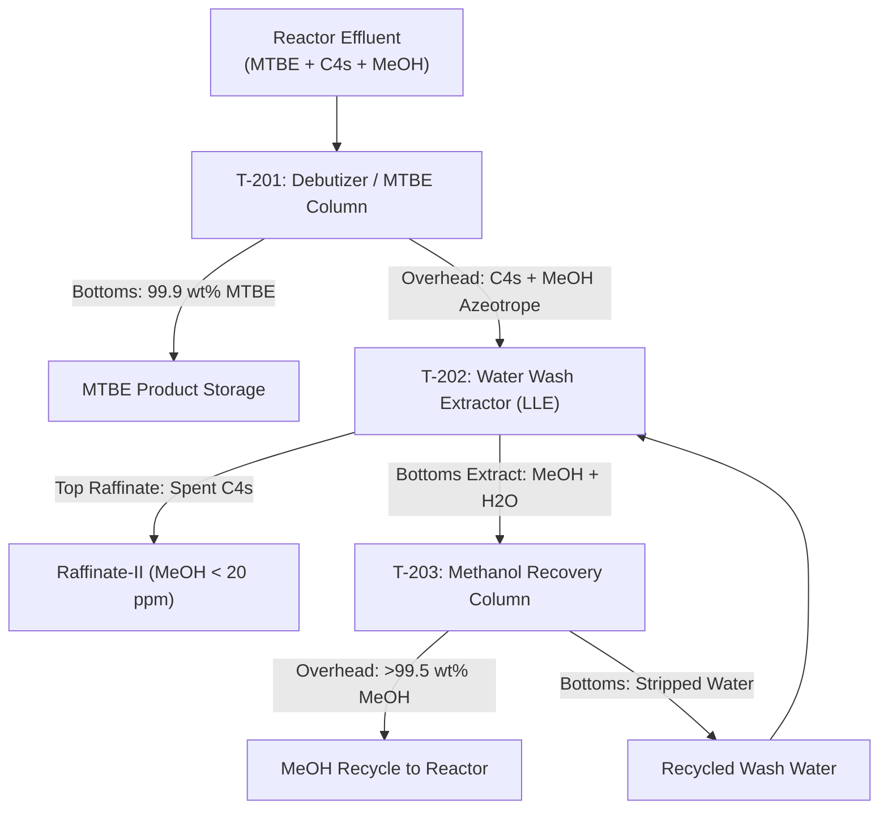

# 2.1 Separation - Steps and sequence

> [!NOTE] Status: Solved (Green)
> **Parent Stage**: `{Separation}`
> **Objective**: Synthesize the flowsheet sequence to recover high-purity MTBE ($>99.9\text{ wt}\%$), separate unreacted C4 hydrocarbons, and recover unreacted green methanol for closed-loop recycle.

---

## 1. Conceptual Design Proposal

A **Three-Unit Hybrid Distillation–Extraction Train** is synthesized from relative volatility hierarchy and azeotropic phase behavior:

1. **T-201 — Debutizer / MTBE Column**: Splits heavy MTBE ($T_b = 55.2^\circ\text{C}$) as bottoms from light C4s. Exploits the **minimum-boiling C4/methanol azeotrope** so residual MeOH goes overhead. Bottoms: **$\ge 99.9\text{ wt}\%$ MTBE**.
2. **T-202 — Methanol Water Wash (LLE)**: Countercurrent extraction with demineralized water; Raffinate-II $<20\text{ ppm}$ MeOH.
3. **T-203 — Methanol Recovery Distillation**: Distills aqueous extract; MeOH recycle to reactor; stripped water returns to T-202 (closed loop).

---

## 2. First-Principles Rationale

### 2.1 Azeotropic Phase Distribution
In a C4-rich matrix, $\gamma^\infty_{\text{MeOH}} \approx 10.5$. Effective $\alpha_{\text{MeOH/MTBE}} \approx 6.5$ under column conditions—so methanol leaves with C4s, not with MTBE bottoms.

### 2.2 Extraction vs. Pressure-Swing Distillation
Pressure-swing or extractive distillation to break C4–MeOH would need high-pressure C4 handling and large energy. Water wash (`EXTR-001`) offers $K_D \approx 25\text{–}40$, near-infinite selectivity, and ambient-ish $T$/moderate $P$.

### 2.3 Closed Recycles
Fresh green MeOH makeup equals stoichiometric consumption only; excess MeOH is recovered in T-203. Wash water is zero-discharge recycled (`PROC-007`).

---

## 3. Justifying Heuristic Rules

| Heuristic ID | Heuristic Rule Summary | Key Guidelines Applied | Source Reference |
| :--- | :--- | :--- | :--- |
| `DIST-001` | Distillation as primary separation | $\alpha_{\text{C4/MTBE}} > 1.25$ → distill T-201 / T-203. | Seider (2010) Heuristic 7 |
| `DIST-002` | Distillation sequencing | Remove plentiful/easy C4s first; recover high-purity product as bottoms. | Turton (2012) Table 11.13 |
| `EXTR-001` | LLE for azeotropes | Water wash for C4/MeOH after debutizer. | Ulrich & Vasudevan (2004) p. 582 |
| `EXTR-002` | Extraction solvent selection | Water: high capacity, non-toxic, stable. | Seider (2010) Heuristic 13 |
| `PROC-004` / `PROC-007` | Recycle MSA & unreacted feeds | MeOH + water closed loops. | Douglas / Turton Table 11.1 |
