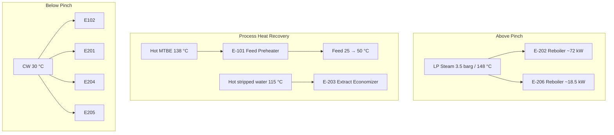

# 3.2 Heat exchangers - Utilities and pinch

> [!NOTE] Status: Solved (Green)
> **Parent Stage**: `{Heat Exchangers}`
> **Objective**: Identify process–process heat matches, set $\Delta T_{\min}$, and specify utility headers (CW, LP steam).

---

## 1. Conceptual Design Proposal

* **$\Delta T_{\min}$**: **$10^\circ\text{C}$** (`HEX-004`).
* **Heating utility**: LP saturated steam **$3.5\text{ barg}$ ($148^\circ\text{C}$)** (`UTIL-REF-003`); $\approx 96\text{ kW}$ net steam duty after integration.
* **Cooling utility**: Mechanical-draft CW **$30^\circ\text{C}$ supply / $\le 40^\circ\text{C}$ return** (`UTIL-REF-001`); dominant duty is debutizer condenser ($\approx 210\text{ kW}$).

---

## 2. First-Principles Rationale

### 2.1 Key Thermal Streams (conceptual)
| Stream | Type | $T_s \to T_t$ | Role |
| :--- | :--- | :--- | :--- |
| MTBE bottoms | Hot | $138 \to 40^\circ\text{C}$ | Drive E-101 feed preheat |
| R-101 effluent | Hot | $74.5 \to 45^\circ\text{C}$ | E-102 intercooler (CW) |
| T-201 overhead | Hot (latent) | $49^\circ\text{C}$ | E-201 condenser (CW) |
| T-203 bottoms water | Hot | $115 \to 35^\circ\text{C}$ | E-203 economizer |
| Reactor feed | Cold | $25 \to 50^\circ\text{C}$ | Matched to MTBE product |
| T-201 / T-203 reboilers | Cold (latent) | $138$ / $115^\circ\text{C}$ | LP steam above pinch |

### 2.2 Pinch Rules (`PROC-010`)
Approximate pinch: $T_{\text{hot}} \approx 125^\circ\text{C}$, $T_{\text{cold}} \approx 115^\circ\text{C}$. Do not transfer heat across the pinch; no CW above pinch; no steam below pinch. Feed–effluent (product) match and water–extract economizer cut steam use by $\approx 20\%$.

### 2.3 Battery-Limit Utilities
Process design guarantees auxiliary services at BL—standard CW and LP steam headers suffice; **no refrigeration** required once debutizer pressure is set for CW condensation.

---

## 3. Justifying Heuristic Rules

| Heuristic ID | Heuristic Rule Summary | Key Guidelines Applied | Source Reference |
| :--- | :--- | :--- | :--- |
| `PROC-010` | Pinch analysis rules | No cross-pinch transfer; correct utility placement. | Linnhoff / Turton Table 11.1 |
| `HEX-004` | Minimum approach $\Delta T_{\min}$ | $10\text{–}20^\circ\text{C}$; specified $10^\circ\text{C}$. | Ulrich & Vasudevan (2004) p. 579 |
| `UTIL-REF-001` | Cooling water levels | Supply $30^\circ\text{C}$, return $\le 40\text{–}45^\circ\text{C}$. | Turton (2012) Table 11.12 |
| `UTIL-REF-003` | Steam header pressures | LP steam $3.5\text{ barg}$ ($148^\circ\text{C}$). | Seider (2010) Heuristic 32 |
