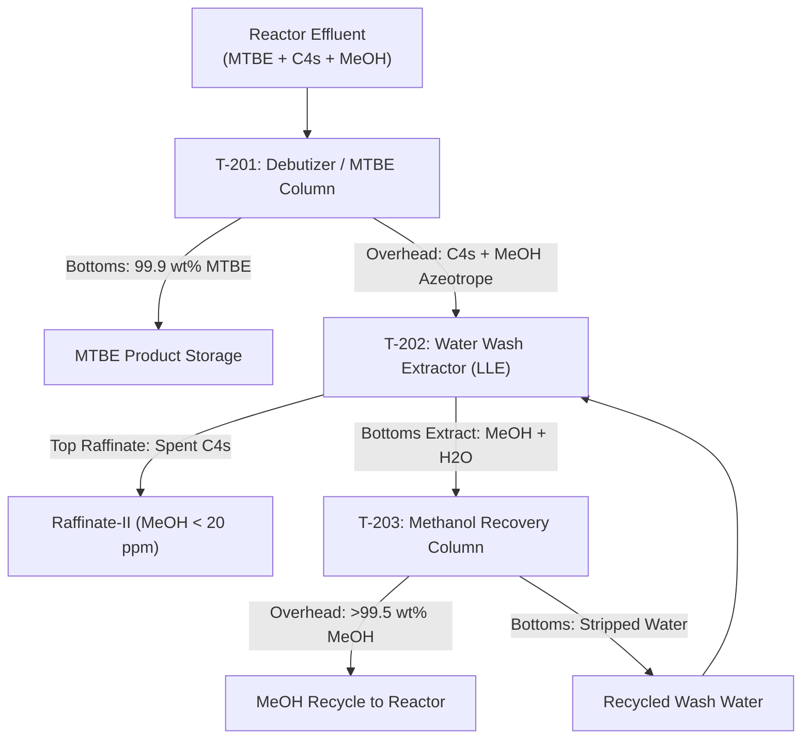
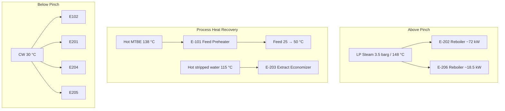

# Conceptual Process Brief: Green MTBE Production

> **Status**: 10/10 blocks completed  
> **Capacity**: 10,000 t/yr naphtha (1,250 kg/h) (8000 h/yr, Continuous)  
> **Product Spec**: MTBE >= 99.9 wt%; Raffinate-II MeOH < 20 ppm  
> **Thermodynamic Model**: NRTL-RK / UNIQUAC-RK  

## Chemical Substances

| Substance | Role | Formula | CAS | MW | Normal B.P. | $T_c$ | $P_c$ | Density | $P^{\text{sat}}$ (25°C) |
| :--- | :--- | :--- | :--- | :--- | :--- | :--- | :--- | :--- | :--- |
| **Isobutene** | Key Reactant | `C4H8` | 115-11-7 | 56.11 | -6.9 °C | 144.8 °C | 40 bar | 0.588 g/cm³ (25°C) | 3.08 bar (25°C) |
| **Methanol** | Green Feed | `CH4O` | 67-56-1 | 32.04 | 64.7 °C | 239.9 °C | 81 bar | 0.790 g/cm³ (25°C) | 0.169 bar (25°C) |
| **Tert-butyl methyl ether** | Target Product | `C5H12O` | 1634-04-4 | 88.15 | 55.2 °C | 223.5 °C | 34.1 bar | 0.736 g/cm³ (25°C) | 0.33 bar (25°C) |
| **Water** | Wash Solvent | `H2O` | 7732-18-5 | 18.02 | 100 °C | 373.9 °C | 220.6 bar | 0.997 g/cm³ (25°C) | 0.032 bar (25°C) |

> **Azeotrope / Phase Note**: Pure methanol boils above MTBE (64.7 vs 55.2 °C), but in a C4-rich matrix γ∞_MeOH ≈ 8–12 creates a minimum-boiling C4/MeOH azeotrope leaving overhead in debutizer T-201, yielding ≥ 99.9 wt% MTBE bottoms.

## Basis & Properties

### BP-01: Basis & Operating Mode (`done`)

Continuous Green MTBE production processing **10,000 t/yr** isobutylene-rich naphtha (1,250 kg/h at 8,000 h/yr; 50% minimum turndown) with green methanol to deliver **≥ 99.9 wt% MTBE**.

| Parameter | Value | Unit | Notes |
| :--- | :--- | :--- | :--- |
| Naphtha Feed Capacity | 10,000 | t/yr (1,250 kg/h) | 19 wt% reactive isobutylene |
| Operating Mode | Continuous | 8,000 h/yr | Capacity > 5,000 t/yr (PROC-002) |
| Minimum Turndown | 50 | % (625 kg/h) | Battery-limit requirement |
| Product Spec | ≥ 99.9 | wt% MTBE | Raffinate-II MeOH < 20 ppm |

**First-Principles Rationale**

Capacity exceeds the 5,000 t/yr continuous threshold (`PROC-002`). Standard 8,000 h/yr stream factor matches plant specification; ChemSystems reference confirms two-stage resin reactor + debutizer + water wash topology.

| Heuristic | Rule Summary | Application | Source |
| :--- | :--- | :--- | :--- |
| `PROC-002` | Select continuous processing for annual capacities exceeding 5,000 metric tons/year; select batch processing for capacities bel... | 10,000 t/yr > 5,000 t/yr threshold -> Continuous mode, 8,000 h/yr. | Turton (2012), Section 2.2 & Table 2.1, p. 93 |
| `PROC-001` | Never use a heuristic rule unless you understand where it came from and how it was derived. | Conceptual screening precedes Aspen Plus / HYSYS simulation. | Turton (2012), Section 11.1 & Epigraph, p. 368 |

### BP-02: Chemical Substances & Thermo Model (`done`)

Retrieved verified pure-component properties for Isobutylene, Methanol, MTBE, and Water; selected **NRTL-RK** (or UNIQUAC-RK) as the thermodynamic model.

| Parameter | Value | Unit | Notes |
| :--- | :--- | :--- | :--- |
| Thermodynamic Model | NRTL-RK | VLE + LLE + Rxn | Handles C4/MeOH azeotrope & water wash LLE |
| Boiling Point Order | i-C4 (-6.9) < MTBE (55.2) < MeOH (64.7) < H2O (100.0) | °C | Azeotrope sends MeOH overhead in T-201 |

**First-Principles Rationale**

Strong polar non-ideality of methanol in C4 hydrocarbons produces a minimum-boiling C4/MeOH azeotrope ($\gamma^\infty \approx 8\text{--}12$) and governs downstream LLE water extraction, requiring an activity-coefficient + EOS hybrid.

| Heuristic | Rule Summary | Application | Source |
| :--- | :--- | :--- | :--- |
| `PROP-001` | For order-of-magnitude preliminary design and verification: 1. Water density: ~1,000 kg/m3 (62.4 lb/ft3 / 8.33 lb/gal). 2. Typi... | Verified pure-component boiling points, densities, and critical constants via DIPPR/chemicals. | Turton (2012), Table 11.2(a), p. 377 |

## 1. Reactor

### RX-01: Reactor Thermodynamics (`done`)

The synthesis of Methyl *tert*-butyl ether (MTBE) is conducted as a liquid-phase, heterogeneously catalyzed equilibrium-limited addition reaction:

$$\text{CH}_3\text{C(CH}_3\text{)=CH}_2 (l) + \text{CH}_3\text{OH} (l) \xrightleftharpoons[\text{Resin Catalyst}]{\Delta H^\circ_{\text{rxn}} = -37.2\text{ kJ/mol}} (\text{CH}_3)_3\text{C}-\text{O}-\text{CH}_3 (l)$$

* **Thermal Classification**: **Moderately Exothermic** ($\Delta H^\circ_{\text{rxn}} = -37.2\text{ kJ/mol}$; $\Delta T_{\text{ad}} \approx 42.4^\circ\text{C}$).
* **Equilibrium Window**: $50^\circ\text{C}$ to $75^\circ\text{C}$ balances high $K_{\text{eq}}$ (permitting $>92\text{–}95\%$ per-pass conversion) with sufficient kinetic rate over macroporous ion-exchange resin.
* **Phase Stability**: Operate at $10\text{–}15\text{ barg}$ so all C4 hydrocarbons and methanol remain liquid—no localized boiling in the catalyst bed.

---

| Parameter | Value | Unit | Notes |
| :--- | :--- | :--- | :--- |
| Heat of Reaction (ΔH°_rxn) | -37.2 | kJ/mol | Moderately exothermic liquid-phase addition |
| Adiabatic Temp Rise (ΔT_ad) | 42.4 | °C | 81 wt% C4 inerts act as internal heat sink |
| Equilibrium Window | 50–75 | °C | Peak strictly < 120 °C resin desulfonation limit |
| MeOH / i-C4 Molar Ratio | 1.05 | mol/mol | 5% excess suppresses DIB dimerization |

**First-Principles Rationale**

### 2.1 Stoichiometry and Molar Flow Rates
From the Basis of Design ($10,000\text{ t/year}$ naphtha, $8,000\text{ h/year}$, $19\text{ wt}\%$ isobutylene):
* **Naphtha Mass Flow**: $\dot{m}_{\text{naphtha}} = 1,250.0\text{ kg/h}$.
* **Isobutylene Feed Rate**: $\dot{m}_{i\text{-C4}} = 1,250 \times 0.19 = 237.5\text{ kg/h}$ ($4.233\text{ kmol/h}$).
* **Methanol Feed Ratio**: $\text{MeOH} : i\text{-C}_4\text{H}_8 = 1.05 : 1.00$ ($5\%$ molar excess).
* **Total Methanol Feed**: $\dot{n}_{\text{MeOH}} = 1.05 \times 4.233 = 4.445\text{ kmol/h}$ ($142.4\text{ kg/h}$).
* **Total Reactor Feed**: $\dot{m}_{\text{feed, tot}} = 1,250.0 + 142.4 = 1,392.4\text{ kg/h}$.

### 2.2 Heat Generation & Adiabatic Temperature Rise ($\Delta T_{\text{ad}}$)
Assuming design primary single-pass conversion $X_{i\text{-C4}} = 90\%$ ($3.810\text{ kmol/h}$ converted):
$$\dot{Q}_{\text{gen}} = (3,810\text{ mol/h}) \cdot (37.2\text{ kJ/mol}) = 141,732\text{ kJ/h} = 39.37\text{ kW}$$

With $C_{p,\text{mix}} \approx 2.40\text{ kJ/(kg}\cdot\text{K)}$:
$$\Delta T_{\text{ad}} = \frac{141,732\text{ kJ/h}}{1,392.4\text{ kg/h} \times 2.40\text{ kJ/(kg}\cdot\text{K)}} \approx 42.4^\circ\text{C}$$

With inlet $50^\circ\text{C}$, unmitigated adiabatic exit would reach $\approx 92^\circ\text{C}$—must be moderated below the resin desulfonation threshold ($120^\circ\text{C}$) and to suppress dimerization.

### 2.3 Side Reactions & Extinction Analysis
1. **Isobutylene Dimerization to Diisobutylene (DIB)**: Suppressed by maintaining $\text{MeOH} : i\text{-C}_4 > 1.00$ (methanol monolayer on $-\text{SO}_3\text{H}$ sites); target DIB $<0.5\text{ wt}\%$.
2. **Hydration to TBA**: Trace TBA is gasoline-compatible and leaves with MTBE bottoms (`PROC-007`).
3. **MeOH → DME**: Negligible below $90^\circ\text{C}$; MTBE selectivity $>99.5\%$.

---

| Heuristic | Rule Summary | Application | Source |
| :--- | :--- | :--- | :--- |
| `REACT-004` | To remove a highly exothermic heat of reaction, use an excess of reactant, an inert diluent, or direct cold-shot fluid injectio... | Excess C4 inerts ($81\text{ wt}\%$ of naphtha) act as internal heat sink; $\Delta T_{\text{ad}} \approx 42.4^\circ\text{C}$. | Seider et al. (2010), Table 6.2, Heuristic 21, p. 156 |
| `REACT-005` | For moderately exothermic heats of reaction, circulate reactor fluid to an external heat exchanger, or use a jacketed vessel, i... | Moderate exotherm ($\Delta T_{\text{ad}} < 100^\circ\text{C}$) → intermediate cooling / staged adiabatic beds. | Seider et al. (2010), Table 6.2, Heuristic 22, p. 156 |
| `PROC-007` | Byproducts produced in small quantities by reversible reactions should not be separated for sale or purged; recycle them to ext... | Trace TBA/DIB need not be isolated if fuel-spec compatible. | Seider et al. (2010), Table 6.2, Heuristic 6, p. 155 |
| `PROC-004` | Use an excess of an inexpensive, non-toxic, or readily available reactant to drive complete consumption of a valuable, toxic, o... | $5\%$ MeOH excess drives conversion and suppresses dimerization. | Seider et al. (2010), Table 6.2, Heuristic 2, p. 155 |

### RX-02: Reactor Type & Catalyst (`done`)

A **Two-Stage Fixed-Bed Catalytic Reactor Train with Intermediate Cooling** is selected for MTBE synthesis:

* **Primary Reactor (R-101)**: Vertical fixed-bed, liquid downflow over macroporous sulfonic acid resin. Converts $\approx 85\text{–}90\%$ of isobutylene. Inlet $50^\circ\text{C}$, exit $\le 75^\circ\text{C}$.
* **Interstage Cooler (E-102)**: Shell-and-tube cooler, $75^\circ\text{C} \to 45\text{–}50^\circ\text{C}$ with cooling water.
* **Finishing Reactor (R-102)**: Second adiabatic fixed bed at lower $T$ ($45^\circ\text{C} \to 55^\circ\text{C}$), exploiting higher $K_{\text{eq}}$ to reach **$>97\text{–}99\%$ overall isobutylene conversion**.
* **Catalyst**: **Amberlyst 15** (or equivalent Purolite CT-175 / Dowex M-31) strongly acidic macroporous cation-exchange resin beads ($d_p = 0.6\text{–}0.8\text{ mm}$).

---

| Parameter | Value | Unit | Notes |
| :--- | :--- | :--- | :--- |
| Reactor Train | R-101 -> E-102 -> R-102 | 2-stage fixed bed | Downflow liquid phase + interstage CW cooler |
| Catalyst | Amberlyst 15 | 0.6–0.8 mm beads | Macroporous sulfonic acid ion-exchange resin |
| Overall i-C4 Conversion | 97–99 | % | Stage 1 ~89%; Stage 2 finishes at 45–55 °C |

**First-Principles Rationale**

### 2.1 PFR vs. CSTR Volume Comparison
MTBE rate decreases with conversion (Langmuir–Hinshelwood / positive-order in isobutylene). For $X = 90\%$:
$$\frac{V_{\text{CSTR}}}{V_{\text{PFR}}} = \frac{X/(1-X)}{\ln(1/(1-X))} \approx 3.91$$
A packed **fixed-bed PFR** is therefore preferred (`REACT-003`).

### 2.2 Two Adiabatic Stages vs. Multi-tubular
At $1,250\text{ kg/h}$ naphtha ($\approx 2.2\text{ m}^3\text{/h}$ liquid), two simple vessels + one external cooler beat a multi-tubular exchanger-reactor on CAPEX, catalyst loading, and maldistribution risk. Stage 1 removes most heat at higher rate; Stage 2 finishes conversion at cooler $T$.

### 2.3 Reactive Distillation (CDTech) Screened Out
`PROC-008` requires evaluating reactive separations for equilibrium-limited chemistry. Catalytic distillation suits mega-scale ($>100,000\text{ t/year}$ MTBE) but licensing and catalyst-bale complexity are disproportionate at $\approx 2,950\text{ t/year}$ MTBE product. Two-stage fixed bed + conventional debutizer meets $\ge 99.9\text{ wt}\%$ purity with standard equipment.

---

| Heuristic | Rule Summary | Application | Source |
| :--- | :--- | :--- | :--- |
| `REACT-003` | For isothermal reactions (or where temperature drops with conversion) with positive-order kinetics, a Plug Flow Reactor (PFR) r... | Positive-order kinetics → PFR / fixed bed minimizes catalyst volume. | Ulrich & Vasudevan (2004), Appendix C, Reactors, p. 581 |
| `REACT-005` | For moderately exothermic heats of reaction, circulate reactor fluid to an external heat exchanger, or use a jacketed vessel, i... | Intercooler between adiabatic beds controls $\Delta T$ and shifts equilibrium. | Seider et al. (2010), Table 6.2, Heuristic 22, p. 156 |
| `REACT-007` | Select catalyst particle sizes based on reactor contact regime: ~0.10 mm (100 microns) for fluidized beds; ~1 mm for slurry bub... | $d_p = 0.5\text{–}1.5\text{ mm}$ balances diffusion vs. $\Delta P$. | Turton (2012), Table 11.17, Rule 2, p. 390 |
| `PROC-008` | For reversible equilibrium-limited reactions, evaluate reactive separation (e.g. reactive distillation) to remove products cont... | CD screened; 2-stage fixed bed selected for this capacity. | Seider et al. (2010), Table 6.2, Heuristic 8, p. 155 |

### RX-03: Reaction Conditions (`done`)

| Parameter | Primary Reactor (R-101) | Secondary Reactor (R-102) | Unit / Specification |
| :--- | :--- | :--- | :--- |
| **Operating Pressure** | $12.0$ | $11.0$ | $\text{barg}$ (liquid phase guaranteed) |
| **Inlet Temperature** | $50.0$ | $45.0$ | $^\circ\text{C}$ |
| **Outlet Temperature** | $74.5$ | $53.0$ | $^\circ\text{C}$ (peak $< 75^\circ\text{C}$) |
| **Feed Molar Ratio ($\text{MeOH}/i\text{-C}_4$)** | $1.05$ | Combined stream | $\text{mol/mol}$ ($5\%$ excess MeOH) |
| **Design Conversion ($X_{i\text{-C4}}$)** | $89.0\%$ | $98.5\%$ (cumulative) | Based on fresh isobutylene |
| **LHSV** | $3.8$ | $7.4$ | $\text{h}^{-1}$ (overall $\approx 2.5\text{ h}^{-1}$) |
| **Catalyst Bed Volume** | $0.60$ | $0.31$ | $\text{m}^3$ ($0.91\text{ m}^3$ total) |
| **Vessel $D_i$** | $0.60$ | $0.50$ | $\text{m}$ |
| **Bed Height** | $2.12$ | $1.58$ | $\text{m}$ ($L/D \approx 3.2\text{–}3.5$) |
| **Allowable $\Delta P$** | $\le 0.45$ | $\le 0.35$ | $\text{bar}$ |

Operating mode (`PROC-002`): **Continuous**, $8,000\text{ h/year}$, minimum utilization **50%** ($625\text{ kg/h}$ naphtha turndown).

---

| Parameter | Value | Unit | Notes |
| :--- | :--- | :--- | :--- |
| Operating Pressure | 12.0 / 11.0 | barg (R-101 / R-102) | 5.8 bar margin above 6.2 barg P_bubble at 75 °C |
| Inlet / Outlet Temp | 50->74.5 / 45->53 | °C | Maintains high K_eq in finishing bed |
| Catalyst Bed Volume | 0.60 / 0.31 | m³ (0.91 m³ total) | LHSV ≈ 2.5 h⁻¹ overall; L/D ≈ 3.2–3.5 |

**First-Principles Rationale**

### 2.1 Bubble Point & Pressure
Feed dominated by isobutane ($35\text{ wt}\%$), 2-butenes ($21\text{ wt}\%$), isobutylene ($19\text{ wt}\%$), and methanol. At peak $75^\circ\text{C}$:
$$P_{\text{bubble}} \approx 6.2\text{ barg}$$
Operating at **$12.0\text{ barg}$** gives $\approx 5.8\text{ bar}$ subcooling margin—full liquid phase, no hot spots, stable downflow.

### 2.2 Feed Pumping (`PROC-009`)
* Naphtha BL: $4.0\text{ barg}$, $25^\circ\text{C}$ → boost to $\approx 13.5\text{ barg}$ (P-101).
* Methanol BL: $0\text{ barg}$, $25^\circ\text{C}$ → boost to $\approx 13.5\text{ barg}$ (P-102).
* Hydraulic power for naphtha pump $\approx 0.56\text{ kW}$ ($\eta \approx 60\%$ → $\sim 1.1\text{ kW}$ motor)—confirming liquid pressurization over gas compression.

### 2.3 Bed Hydraulics
For $d_p = 0.75\text{ mm}$, $\varepsilon = 0.38$, Ergun estimate gives bed $\Delta P \ll 1.5\text{ bar}$ crushing limit of Amberlyst 15.

---

| Heuristic | Rule Summary | Application | Source |
| :--- | :--- | :--- | :--- |
| `REACT-002` | Reaction rates must be established experimentally in the laboratory, and residence time or space velocity must eventually be ve... | $T \le 75^\circ\text{C}$ vs. resin limit $>120^\circ\text{C}$. | Turton (2012), Table 11.17, Heuristic 1, p. 390 |
| `PROC-002` | Select continuous processing for annual capacities exceeding 5,000 metric tons/year; select batch processing for capacities bel... | Capacity $10,000\text{ t/year} > 5,000$ → continuous, $8,000\text{ h/year}$. | Turton (2012), Section 2.2 & Table 2.1, p. 93 |
| `PROC-009` | To increase the pressure of a stream, pump a liquid rather than compress a gas, unless refrigeration or reaction phase constrai... | Pressurize liquid feeds before reactor. | Seider et al. (2010), Table 6.2, Heuristic 43, p. 158 |
| `REACT-007` | Select catalyst particle sizes based on reactor contact regime: ~0.10 mm (100 microns) for fluidized beds; ~1 mm for slurry bub... | Bead size and $L/D$ keep $\Delta P$ well below crush strength. | Turton (2012), Table 11.17, Rule 2, p. 390 |

## 2. Separation

### SP-01: Separation Steps & Sequence (`done`)

A **Three-Unit Hybrid Distillation–Extraction Train** is synthesized from relative volatility hierarchy and azeotropic phase behavior:

1. **T-201 — Debutizer / MTBE Column**: Splits heavy MTBE ($T_b = 55.2^\circ\text{C}$) as bottoms from light C4s. Exploits the **minimum-boiling C4/methanol azeotrope** so residual MeOH goes overhead. Bottoms: **$\ge 99.9\text{ wt}\%$ MTBE**.
2. **T-202 — Methanol Water Wash (LLE)**: Countercurrent extraction with demineralized water; Raffinate-II $<20\text{ ppm}$ MeOH.
3. **T-203 — Methanol Recovery Distillation**: Distills aqueous extract; MeOH recycle to reactor; stripped water returns to T-202 (closed loop).

---

| Parameter | Value | Unit | Notes |
| :--- | :--- | :--- | :--- |
| T-201 Debutizer | Bottoms ≥ 99.9 wt% MTBE | Distillation | C4 + MeOH azeotrope leaves overhead |
| T-202 Water Wash | Raffinate-II < 20 ppm MeOH | LLE Extraction | Countercurrent demineralized water (K_D ≈ 25–40) |
| T-203 MeOH Recovery | > 99.5 wt% MeOH recycle | Distillation | Closed-loop stripped water returns to T-202 |

**First-Principles Rationale**

### 2.1 Azeotropic Phase Distribution
In a C4-rich matrix, $\gamma^\infty_{\text{MeOH}} \approx 10.5$. Effective $\alpha_{\text{MeOH/MTBE}} \approx 6.5$ under column conditions—so methanol leaves with C4s, not with MTBE bottoms.

### 2.2 Extraction vs. Pressure-Swing Distillation
Pressure-swing or extractive distillation to break C4–MeOH would need high-pressure C4 handling and large energy. Water wash (`EXTR-001`) offers $K_D \approx 25\text{–}40$, near-infinite selectivity, and ambient-ish $T$/moderate $P$.

### 2.3 Closed Recycles
Fresh green MeOH makeup equals stoichiometric consumption only; excess MeOH is recovered in T-203. Wash water is zero-discharge recycled (`PROC-007`).

---

| Heuristic | Rule Summary | Application | Source |
| :--- | :--- | :--- | :--- |
| `DIST-001` | Distillation is the primary, most economical method for separating miscible liquid mixtures when relative volatility alpha > 1.... | $\alpha_{\text{C4/MTBE}} > 1.25$ → distill T-201 / T-203. | Seider et al. (2010), Table 6.2, Heuristic 9, p. 155 |
| `DIST-002` | For multi-component distillation trains, apply the standard sequencing heuristics: 1. Perform the easiest separation first (hig... | Remove plentiful/easy C4s first; recover high-purity product as bottoms. | Turton (2012), Table 11.13, Heuristic 4, p. 386 |
| `EXTR-001` | Specify liquid-liquid extraction (LLE) when components have low relative volatility (alpha < 1.05), form close-boiling azeotrop... | Water wash for C4/MeOH after debutizer. | Turton (2012), Section 2.5, p. 110 |
| `EXTR-002` | Select extraction solvents satisfying: 1. High selectivity (beta = (y_A/x_A) / (y_B/x_B) >= 5 to 10). 2. High distribution coef... | Water: high capacity, non-toxic, stable. | Turton (2012), Table 11.16, Rules 5 & 7, p. 389 |
| `PROC-004` | Use an excess of an inexpensive, non-toxic, or readily available reactant to drive complete consumption of a valuable, toxic, o... | MeOH + water closed loops. | Seider et al. (2010), Table 6.2, Heuristic 2, p. 155 |
| `PROC-007` | Byproducts produced in small quantities by reversible reactions should not be separated for sale or purged; recycle them to ext... | MeOH + water closed loops. | Seider et al. (2010), Table 6.2, Heuristic 6, p. 155 |

### SP-02: Separation Conditions (`done`)

| Equipment ID | Service / Type | Operating Pressure | Top / Bottom Temp. | Stages | Reflux Ratio ($R$) | $D_i$ | Internals |
| :--- | :--- | :--- | :--- | :--- | :--- | :--- | :--- |
| **T-201** | Debutizer / MTBE Column | $6.5\text{ barg}$ | $49^\circ\text{C} \,/\, 138^\circ\text{C}$ | $36$ theor. | $1.15$ ($\approx 1.25 R_{\min}$) | $0.65\text{ m}$ | Structured packing (Mellapak 250Y) |
| **T-202** | MeOH Water Extractor | $6.0\text{ barg}$ | $35^\circ\text{C} \,/\, 38^\circ\text{C}$ | $6$ theor. | N/A (LLE) | $0.35\text{ m}$ | 1" SS Pall rings |
| **T-203** | Methanol Recovery | $1.2\text{ barg}$ | $78^\circ\text{C} \,/\, 115^\circ\text{C}$ | $24$ theor. | $1.20$ ($\approx 1.25 R_{\min}$) | $0.30\text{ m}$ | Structured packing (Mellapak 250Y) |

---

| Parameter | Value | Unit | Notes |
| :--- | :--- | :--- | :--- |
| T-201 Pressure & Temps | 6.5 barg | 49 / 138 °C | 36 stages, R=1.15 | CW condensation (ΔT=19°C); Di=0.65m Mellapak 250Y |
| T-202 Extractor | 6.0 barg | 35–38 °C | 6 stages, S/F=0.15 | Di=0.35m 1" SS Pall rings; organic dispersed |
| T-203 Pressure & Temps | 1.2 barg | 78 / 115 °C | 24 stages, R=1.20 | Di=0.30m Mellapak 250Y; LP steam reboiler |

**First-Principles Rationale**

### 2.1 Column Pressure (`DIST-003`)
* Operate at the lowest $P$ that allows **cooling-water condensation** (supply $30^\circ\text{C}$).
* **T-201**: At $1\text{ atm}$, isobutane would need refrigeration ($T_b = -11.7^\circ\text{C}$). At **$6.5\text{ barg}$**, overhead bubble point $\approx 49^\circ\text{C}$ → $\Delta T \approx 19^\circ\text{C}$ to CW; bottoms MTBE $\approx 138^\circ\text{C}$ (below $\sim 160^\circ\text{C}$ decomposition).
* **T-203**: $1.2\text{ barg}$ → MeOH condenses at $78^\circ\text{C}$; water reboils at $115^\circ\text{C}$ with LP steam.

### 2.2 Reflux & Stages (`DIST-004`, `DIST-005`)
* Favorable $\alpha_{\text{C4/MTBE}} \approx 6$ → $N \approx 1.8 N_{\min} \approx 36$; $R = 1.2\text{–}1.3 R_{\min}$.
* $D_i = 0.65\text{ m} < 0.9\text{ m}$ → structured packing preferred over trays.

### 2.3 Extractor (`EXTR-003`, `EXTR-004`)
* $S/F \approx 0.15$, $\mathcal{E} \approx 4.5$ → **6 theoretical stages**.
* $V_{\text{org}}/V_{\text{aq}} \approx 11.5$ → disperse hydrocarbon phase.

---

| Heuristic | Rule Summary | Application | Source |
| :--- | :--- | :--- | :--- |
| `DIST-003` | Operate distillation columns at the lowest feasible pressure, because relative volatility increases as pressure decreases. The... | Set $P$ for CW condensation; keep bottoms $T$ moderate. | Turton (2012), Table 11.13, Rule 3, p. 386 |
| `DIST-004` | Set the operating reflux ratio R between 1.1 and 1.5 times the minimum reflux ratio (R_min), with 1.2 to 1.3 R_min being the st... | $R = 1.2\text{–}1.3 R_{\min}$; $N = 1.5\text{–}2.0 N_{\min}$. | Turton (2012), Table 11.13, Rules 5-9, p. 386 |
| `DIST-005` | Use tray columns for column diameters > 0.6 to 0.9 m (2 to 3 ft), high liquid flow rates, fouling fluids, slurries, or when int... | $D < 0.9\text{ m}$ → structured packing. | Turton (2012), Tables 11.13, 11.14, 11.15, p. 386 |
| `EXTR-003` | Most commercial extraction cascades require 4 to 10 theoretical stages. Select equipment by stage count and interfacial tension... | Commercial cascades typically 4–10 stages; specified 6. | Turton (2012), Table 11.16, Rules 3-9, p. 389 |
| `EXTR-004` | Disperse the phase with the higher volumetric flow rate in column extractors to maximize interfacial mass transfer area, unless... | Disperse higher volumetric-flow phase (organic). | Turton (2012), Table 11.16, Rule 1, p. 389 |

## 3. Heat Exchangers

### HX-01: Heat Exchanger Types (`done`)

Eight conceptual heat-transfer services across reaction, debutizer, extraction, and MeOH recovery:

| Tag | Service | Type | Duty (kW) | Tube-Side | Shell-Side | Geometry |
| :--- | :--- | :--- | :--- | :--- | :--- | :--- |
| **E-101** | Feed / MTBE economizer | TEMA BEU | $23.5$ | Fresh feed (high $P$, `HEX-002`) | Hot MTBE product | $3/4''$ OD, $1''$ tri, $16\text{ ft}$ |
| **E-102** | Reactor intercooler | TEMA AES | $27.4$ | Cooling water (fouling) | Reactor effluent | Same standard |
| **E-201** | Debutizer condenser | TEMA AES | $210$ | Cooling water | Condensing C4/MeOH | Same standard |
| **E-202** | Debutizer reboiler | TEMA BKU kettle | $72$ | LP steam | Boiling MTBE | U-tube, vapor space |
| **E-203** | Extract / water economizer | Hairpin / P&F | $14.5$ | Aqueous extract | Hot stripped water | Countercurrent |
| **E-204** | Wash-water trim cooler | BEM / hairpin | $4.2$ | Cooling water | Recycle water | Compact |
| **E-205** | MeOH condenser | TEMA AES | $16.8$ | Cooling water | Condensing MeOH | $3/4''$, $12\text{ ft}$ |
| **E-206** | MeOH recovery reboiler | Thermosiphon | $18.5$ | LP steam (throttled) | Boiling water | Vertical |

---

| Parameter | Value | Unit | Notes |
| :--- | :--- | :--- | :--- |
| Primary Exchangers | 8 services (E-101..E-206) | TEMA AES/BEU/BKU | 3/4" OD tubes, 1" tri pitch, 16 ft standard |
| Debutizer Condenser (E-201) | 210 | kW | CW on tube side; condensing C4/MeOH on shell |
| Debutizer Reboiler (E-202) | 72 | kW (ΔT=10°C) | LP steam 3.5 barg; ΔT ≤ 25°C nucleate boiling |

**First-Principles Rationale**

### 2.1 Tube vs. Shell (`HEX-002`)
* Cooling water → **tube side** (cleaning / fouling).
* High-pressure reactor feed → **tube side** (hoop stress).
* Condensing / boiling streams → **shell side** (low $\Delta P$, vapor disengagement).

### 2.2 Standard Geometry (`HEX-001`)
$3/4''$ OD tubes, $1''$ triangular pitch, $16\text{ ft}$ lengths for primary S&T units.

### 2.3 Nucleate Boiling (`HEX-007`)
* **E-202**: $T_{\text{steam}}(3.5\text{ barg}) = 148^\circ\text{C}$, $T_{\text{MTBE}} = 138^\circ\text{C}$ → $\Delta T = 10^\circ\text{C} \le 25^\circ\text{C}$.
* **E-206**: Throttled steam $2.0\text{ barg}$ ($133^\circ\text{C}$) vs. water $115^\circ\text{C}$ → $\Delta T = 18^\circ\text{C} \le 25^\circ\text{C}$.

---

| Heuristic | Rule Summary | Application | Source |
| :--- | :--- | :--- | :--- |
| `HEX-001` | For standard shell-and-tube heat exchangers, specify 3/4-inch (19.05 mm) OD tubes on a 1-inch (25.4 mm) triangular pitch, with... | $3/4''$ OD, $1''$ tri pitch, $16\text{ ft}$. | Turton (2012), Table 11.11, Rule 2, p. 385 |
| `HEX-002` | Allocate fluids between tube side and shell side according to the standard priority hierarchy: 1. Tube side: corrosive fluids (... | Fouling / HP / CW on tubes; condensing/boiling on shell. | Turton (2012), Table 11.11, Rules 3 & 4, p. 385 |
| `HEX-007` | In reboilers and vaporizers, maintain the maximum overall temperature driving force Delta T_driving <= 45 F (25 C) to ensure nu... | Keep $\Delta T \le 25^\circ\text{C}$ for nucleate boiling. | Seider et al. (2010), Table 6.2, Heuristic 28, p. 157 |
| `HEX-010` | Specify double-pipe or multi-pipe hairpin heat exchangers when required heat transfer area is small (< 100 to 200 ft2 / 10 to 2... | E-203 / E-204 when $A < 20\text{ m}^2$. | Turton (2012), Table 11.11, Rule 9, p. 385 |

### HX-02: Utilities & Pinch (`done`)

* **$\Delta T_{\min}$**: **$10^\circ\text{C}$** (`HEX-004`).
* **Heating utility**: LP saturated steam **$3.5\text{ barg}$ ($148^\circ\text{C}$)** (`UTIL-REF-003`); $\approx 96\text{ kW}$ net steam duty after integration.
* **Cooling utility**: Mechanical-draft CW **$30^\circ\text{C}$ supply / $\le 40^\circ\text{C}$ return** (`UTIL-REF-001`); dominant duty is debutizer condenser ($\approx 210\text{ kW}$).

---

| Parameter | Value | Unit | Notes |
| :--- | :--- | :--- | :--- |
| Minimum Approach (ΔT_min) | 10 | °C | HEX-004 guideline (10–20 °C) |
| Process Heat Recovery | E-101 (23.5 kW) + E-203 (14.5 kW) | ~20% steam saved | MTBE->Feed preheat & Stripped water->Extract |
| Utility Headers | LP Steam 3.5 barg (148°C) | CW 30->40°C | No refrigeration | Pinch ~125°C hot / 115°C cold |

**First-Principles Rationale**

### 2.1 Key Thermal Streams (conceptual)
| Stream | Type | $T_s \to T_t$ | Role |
| :--- | :--- | :--- | :--- |
| MTBE bottoms | Hot | $138 \to 40^\circ\text{C}$ | Drive E-101 feed preheat |
| R-101 effluent | Hot | $74.5 \to 45^\circ\text{C}$ | E-102 intercooler (CW) |
| T-201 overhead | Hot (latent) | $49^\circ\text{C}$ | E-201 condenser (CW) |
| T-203 bottoms water | Hot | $115 \to 35^\circ\text{C}$ | E-203 economizer |
| Reactor feed | Cold | $25 \to 50^\circ\text{C}$ | Matched to MTBE product |
| T-201 / T-203 reboilers | Cold (latent) | $138$ / $115^\circ\text{C}$ | LP steam above pinch |

### 2.2 Pinch Rules (`PROC-010`)
Approximate pinch: $T_{\text{hot}} \approx 125^\circ\text{C}$, $T_{\text{cold}} \approx 115^\circ\text{C}$. Do not transfer heat across the pinch; no CW above pinch; no steam below pinch. Feed–effluent (product) match and water–extract economizer cut steam use by $\approx 20\%$.

### 2.3 Battery-Limit Utilities
Process design guarantees auxiliary services at BL—standard CW and LP steam headers suffice; **no refrigeration** required once debutizer pressure is set for CW condensation.

---

| Heuristic | Rule Summary | Application | Source |
| :--- | :--- | :--- | :--- |
| `PROC-010` | Follow the fundamental Pinch Analysis rules: Never transfer heat across the pinch. Above the pinch, only accept heat from hot u... | No cross-pinch transfer; correct utility placement. | Turton (2012), Section 2.6 & Chapter 15 (Pinch Technology), p. 536 |
| `HEX-004` | Specify near-optimal minimum approach temperatures (Delta T_min) based on temperature regime: 1. Sub-ambient / cryogenic temper... | $10\text{–}20^\circ\text{C}$; specified $10^\circ\text{C}$. | Seider et al. (2010), Table 6.2, Heuristic 26, p. 157 |
| `UTIL-REF-001` | Standard cooling tower water is supplied to process exchangers at 85 to 90 F (29 to 32 C) and returned at a maximum allowable t... | Supply $30^\circ\text{C}$, return $\le 40\text{–}45^\circ\text{C}$. | Seider et al. (2010), Table 6.2, Heuristic 27, p. 157 |
| `UTIL-REF-003` | Specify utility steam distribution at standardized header pressure levels: 1. High Pressure (HP): 40 to 45 bara (580 to 650 psi... | LP steam $3.5\text{ barg}$ ($148^\circ\text{C}$). | Ulrich & Vasudevan (2004), Appendix C, Process Steam, p. 573 |

## 4. Conceptual Brief

### SM-01: Conceptual Process Brief (`done`)

# Process Summary: Conceptual Process Brief for Green MTBE Plant

> **Project**: Conceptual Process Plan for Green MTBE Production from Isobutylene-Rich Naphtha  
> **Workspace**: `Example1/`  
> **Target Capacity**: $10,000\text{ metric tons/year}$ Naphtha ($8,000\text{ operating hr/year}$)  
> **Status**: 🟢 Conceptual Screening Complete & Heuristically Validated

---

## 1. Target & Capacity (`PROC-002`)

* **Operating Mode**: **Continuous** ($1,250\text{ kg/h}$ naphtha; $8,000\text{ hr/year}$).
* **Turndown**: Minimum **50%** utilization ($625\text{ kg/h}$).
* **Product Spec**: MTBE $\ge 99.9\text{ wt}\%$.
* **Primary Chemistry**:
  $$\text{Isobutylene} + \text{Methanol} \xrightleftharpoons[\text{Amberlyst 15}]{\Delta H^\circ = -37.2\text{ kJ/mol}} \text{MTBE}$$
* **Thermodynamic Model**: **NRTL-RK** or **UNIQUAC-RK** (polar MeOH non-ideality, C4/MeOH azeotropes, LLE water wash).

---

## 2. Reaction Basis ({Reactor})

* **Configuration**: Two-stage liquid-phase fixed-bed train with intercooler (R-101 → E-102 → R-102).
* **Catalyst**: Amberlyst 15 (or equivalent) macroporous sulfonic resin, $d_p \approx 0.6\text{–}0.8\text{ mm}$.
* **Window**: $12\text{ barg}$ liquid phase; $50\text{–}75^\circ\text{C}$ (peak $<120^\circ\text{C}$ resin limit); $\text{MeOH}/i\text{-C}_4 = 1.05$.
* **Thermal**: Moderate exotherm, $\Delta T_{\text{ad}} \approx 42.4^\circ\text{C}$; C4 inerts provide heat sink.

---

## 3. Separation Basis ({Separation})

1. **T-201 Debutizer** ($6.5\text{ barg}$): MTBE bottoms $\ge 99.9\text{ wt}\%$; C4 + azeotropic MeOH overhead (CW-condensable).
2. **T-202 Water Wash (LLE)**: Raffinate-II with MeOH $<20\text{ ppm}$.
3. **T-203 MeOH Recovery** ($1.2\text{ barg}$): Recycle MeOH to reactor; closed water loop to T-202.

---

## 4. Energy Basis ({Heat Exchangers})

* **Recovery**: E-101 feed/MTBE economizer; E-203 extract/water economizer ($\approx 20\%$ steam savings).
* **Utilities**: LP steam $3.5\text{ barg}$ ($148^\circ\text{C}$); CW $30^\circ\text{C}$ supply—no refrigeration.
* **$\Delta T_{\min}$**: $10^\circ\text{C}$; reboiler approaches kept $\le 25^\circ\text{C}$ (nucleate boiling).

---

## 5. Next Step

Conceptual framework, chemical data, equipment families, and operating envelopes are established. Proceed to build the rigorous flowsheet in **Aspen Plus**, **Aspen HYSYS**, or **DWSIM**.

| Parameter | Value | Unit | Notes |
| :--- | :--- | :--- | :--- |
| Readiness | Conceptual Plan Complete | 10/10 blocks | Ready for Aspen Plus / HYSYS / DWSIM |

| Heuristic | Rule Summary | Application | Source |
| :--- | :--- | :--- | :--- |
| `PROC-001` | Never use a heuristic rule unless you understand where it came from and how it was derived. | All decisions grounded in verified heuristics; ready for simulator authentication (PAR). | Turton (2012), Section 11.1 & Epigraph, p. 368 |
| `PROC-002` | Select continuous processing for annual capacities exceeding 5,000 metric tons/year; select batch processing for capacities bel... | Continuous 10,000 t/yr (8,000 h/yr) basis confirmed. | Turton (2012), Section 2.2 & Table 2.1, p. 93 |
| `PROC-010` | Follow the fundamental Pinch Analysis rules: Never transfer heat across the pinch. Above the pinch, only accept heat from hot u... | Pinch-consistent economizers + CW/LP steam utilities (no refrigeration). | Turton (2012), Section 2.6 & Chapter 15 (Pinch Technology), p. 536 |
