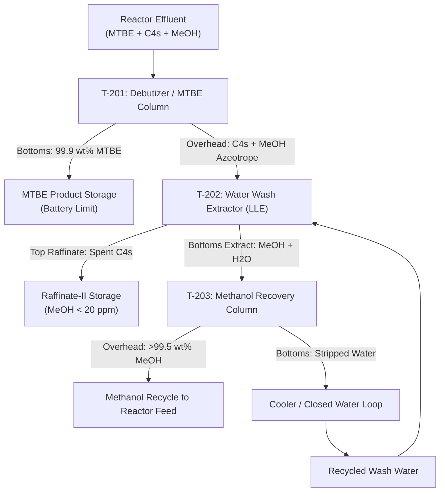

# 2.1 Separation - Steps and sequence

> [!NOTE] Status: Solved (Green)
> **Parent Stage**: `{Separation}`
> **Objective**: Synthesize the flowsheet sequence to recover high-purity MTBE ($>99.9\text{ wt}\%$), separate unreacted C4 hydrocarbons, and recover unreacted green methanol for closed-loop recycle.

---

## 1. Preliminary Engineering Design Proposal

A **Three-Unit Hybrid Distillation-Extraction Train** is synthesized based on relative volatility hierarchy and azeotropic phase behavior:

1. **Unit 1 — Debutizer / MTBE Fractionation Column (T-201)**:
   - Separates heavy MTBE ($T_b = 55.2^\circ\text{C}$) as bottom product from the light C4 hydrocarbons ($T_b = -11.7^\circ\text{C} \text{ to } +3.7^\circ\text{C}$).
   - Exploits the **minimum-boiling C4/methanol azeotrope**: although pure methanol boils at $64.7^\circ\text{C}$, in the presence of C4 hydrocarbons it exhibits severe positive non-ideality ($\gamma_{\text{MeOH}} \approx 8-12$), driving all residual methanol overhead with the C4s.
   - **Bottoms Purity**: MTBE is recovered at **$>99.9\text{ wt}\%$ purity**, satisfying the design specification directly.
2. **Unit 2 — Methanol Extraction / Water Wash Column (T-202)**:
   - Countercurrent liquid-liquid extraction (LLE) using demineralized water as mass separating agent.
   - Strips methanol from the C4 distillate. Overhead Raffinate-II contains $<20\text{ ppm}$ methanol, suitable for LPG or alkylation feedstocks.
3. **Unit 3 — Methanol Recovery Distillation Column (T-203)**:
   - Distills the aqueous extract ($15-25\text{ wt}\%$ methanol). Overhead yields $>99.5\text{ wt}\%$ green methanol for direct recycle to the reactor feed (`PROC-004`).
   - Bottoms yields stripped water ($<50\text{ ppm}$ methanol), recycled in a closed circuit back to T-202 (`PROC-007`).

---

## 2. First-Principles Rationale & Derivations

### 2.1 Azeotropic Phase Distribution Analysis
In a conventional binary mixture, methanol ($T_b = 64.7^\circ\text{C}$) would be heavier than MTBE ($T_b = 55.2^\circ\text{C}$). However, in this multi-component mixture:
* The hydrocarbon matrix consists of $>70\text{ wt}\%$ C4 alkanes and alkenes.
* The infinite-dilution activity coefficient of methanol in butanes is $\gamma^\infty_{\text{MeOH}} \approx 10.5$.
* The effective partial pressure of methanol:
  $$P_{\text{MeOH}} = x_{\text{MeOH}} \cdot \gamma_{\text{MeOH}} \cdot P^\circ_{\text{vap, MeOH}}$$
  At $70^\circ\text{C}$, $P^\circ_{\text{vap, MeOH}} = 1.3\text{ bar}$, while $P^\circ_{\text{vap, MTBE}} = 1.6\text{ bar}$. With $\gamma_{\text{MeOH}} \approx 8.0$, the apparent volatility of methanol becomes $\alpha_{\text{MeOH/MTBE}} \approx \frac{8.0 \cdot 1.3}{1.0 \cdot 1.6} \approx 6.5$.
* Therefore, methanol boils off with the C4s, leaving pure MTBE at the column bottom.

### 2.2 Extraction vs. Pressure-Swing / Extractive Distillation
Breaking the C4-methanol azeotrope via distillation alone would require:
1. Two high-pressure columns operating at differing pressure swings, requiring substantial compression energy.
2. High capital cost for high-pressure cryogenic C4 handling.
By contrast, liquid-liquid water washing (`EXTR-001`):
* Water has an exceptionally high distribution coefficient for methanol ($K_D = y_{\text{MeOH, aq}} / x_{\text{MeOH, org}} \approx 25 - 40$).
* Mutual hydrocarbon-water solubility is $<0.01\text{ wt}\%$, giving selectivity $\beta \to \infty$.
* Water wash operates at ambient temperature ($35-40^\circ\text{C}$) and pressure ($6\text{ barg}$), preserving the liquid state with minimal utility requirements.

### 2.3 Closed Recycle Loops & Environmental Integrity
* **Methanol Balance**: Fresh green methanol makes up only what is stoichiometrically consumed to form MTBE ($134.3\text{ kg/h}$). The excess $8.14\text{ kg/h}$ circulating through the reactor is completely recovered in T-203 overhead and recycled, achieving $\approx 99.8\%$ overall methanol utilization.
* **Zero Wastewater Discharge**: By recovering water in T-203 bottoms and returning it to T-202, the wash water is maintained in a 100% closed loop (`PROC-007`).

---

## 3. Justifying Heuristic Rules

| Heuristic ID | Heuristic Rule Summary | Key Guidelines & Equations Applied | Source Reference |
| :--- | :--- | :--- | :--- |
| `DIST-001` | Distillation as primary separation | Use distillation when relative volatility $\alpha > 1.25$. Applied to T-201 ($\alpha \approx 6.0$) and T-203 ($\alpha \approx 2.8$). | Seider (2010) Heuristic 7 |
| `DIST-002` | Distillation sequencing heuristics | 1. Remove plentiful components early (C4s are $71\%$ of feed). 2. Easiest separation first ($\alpha_{\text{C4/MTBE}} > 5.5$). 3. Recover high purity product directly as bottoms. | Turton (2012) Table 11.13 |
| `EXTR-001` | Liquid-liquid extraction for azeotropes | Specify LLE when distillation is infeasible due to azeotropes or low relative volatility. Water wash selected for C4/MeOH separation. | Ulrich & Vasudevan (2004) p. 582 |
| `EXTR-002` | Extraction solvent selection | Water exhibits near-infinite selectivity ($\beta \gg 10$), high capacity, non-toxicity, and high chemical stability with zero fouling. | Seider (2010) Heuristic 13 |
| `PROC-004` | Mass separating agent recycle | Solvent from extraction (water) and unreacted raw material (methanol) must be separated and recycled to near-extinction. | Turton Table 11.1 / Douglas |
| `PROC-007` | Recycle reversible species | Recycle unreacted methanol overhead from T-203 to reactor inlet to maintain overall stoichiometric efficiency. | Douglas (1988) Chapter 2 |
