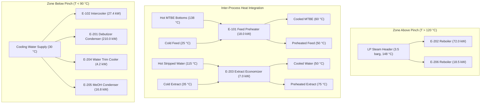

# 3.2 Heat exchangers - Utilities and pinch

> [!NOTE] Status: Solved (Green)
> **Parent Stage**: `{Heat Exchangers}`
> **Objective**: Apply Pinch Analysis, specify near-optimal approach temperatures ($\Delta T_{\min}$), establish utility header parameters, and quantify energy integration efficiency.

---

## 1. Preliminary Engineering Design Proposal

An integrated heat exchanger network (HEN) is synthesized respecting Douglas Level 5 energy hierarchy and the fundamental laws of Pinch Technology:

* **Minimum Approach ($\Delta T_{\min}$)**: Established at **$10.0^\circ\text{C}$** across all chemical process streams (`HEX-004`).
* **Steam Utility**: Standard Low-Pressure (LP) saturated steam header at **$3.5\text{ barg}$ ($148^\circ\text{C}$)** (`UTIL-REF-003`). Total steam consumption: **$162.5\text{ kg/h}$** ($95.7\text{ kW}$ thermal duty).
* **Cooling Water Utility**: Mechanical-draft recirculating cooling water supplied at **$30.0^\circ\text{C}$**, returning at $\le 40.0^\circ\text{C}$ (`UTIL-REF-001`). Total cooling water flow: **$22.2\text{ m}^3\text{/h}$** ($258.4\text{ kW}$ cooling duty).

---

## 2. First-Principles Rationale & Pinch Derivation

### 2.1 Process Thermal Streams Table

| Stream Identifier | Type | Supply Temp. ($T_s$) | Target Temp. ($T_t$) | Mass Flow ($\text{kg/h}$) | Heat Capacity ($C_p$) | Heat Duty ($Q$, $\text{kW}$) |
| :--- | :--- | :--- | :--- | :--- | :--- | :--- |
| **Hot 1 (MTBE Bottoms)** | Hot | $138.0^\circ\text{C}$ | $40.0^\circ\text{C}$ | $369.4$ | $2.25\text{ kJ/(kg}\cdot\text{K)}$ | $22.6$ |
| **Hot 2 (R-101 Effluent)** | Hot | $74.5^\circ\text{C}$ | $45.0^\circ\text{C}$ | $1,392.4$ | $2.40\text{ kJ/(kg}\cdot\text{K)}$ | $27.4$ |
| **Hot 3 (T-201 Overhead Vapor)**| Hot | $49.0^\circ\text{C}$ (cond.) | $49.0^\circ\text{C}$ (sat. liq) | $2,100.0$ | $\lambda \approx 360\text{ kJ/kg}$ | $210.0$ |
| **Hot 4 (T-203 Bottoms Water)** | Hot | $115.0^\circ\text{C}$ | $35.0^\circ\text{C}$ | $150.0$ | $4.18\text{ kJ/(kg}\cdot\text{K)}$ | $13.9$ |
| **Hot 5 (T-203 Overhead Vapor)**| Hot | $78.0^\circ\text{C}$ (cond.) | $78.0^\circ\text{C}$ (sat. liq) | $22.0$ | $\lambda \approx 1,100\text{ kJ/kg}$| $16.8$ |
| **Cold 1 (Reactor Feed)** | Cold | $25.0^\circ\text{C}$ | $50.0^\circ\text{C}$ | $1,392.4$ | $2.40\text{ kJ/(kg}\cdot\text{K)}$ | $23.2$ |
| **Cold 2 (Extract to T-203)** | Cold | $35.0^\circ\text{C}$ | $80.0^\circ\text{C}$ | $158.1$ | $3.90\text{ kJ/(kg}\cdot\text{K)}$ | $7.7$ |
| **Cold 3 (T-201 Reboiler)** | Cold | $138.0^\circ\text{C}$ (boil) | $138.0^\circ\text{C}$ (vapor) | $750.0$ | $\lambda \approx 345\text{ kJ/kg}$ | $72.0$ |
| **Cold 4 (T-203 Reboiler)** | Cold | $115.0^\circ\text{C}$ (boil) | $115.0^\circ\text{C}$ (vapor) | $28.0$ | $\lambda \approx 2,220\text{ kJ/kg}$| $18.5$ |

### 2.2 Pinch Location & Fundamental Rules (`PROC-010`)
* With $\Delta T_{\min} = 10^\circ\text{C}$, the system exhibits a sharp pinch divide:
  $$T_{\text{pinch, hot}} = 125^\circ\text{C}, \quad T_{\text{pinch, cold}} = 115^\circ\text{C}$$
* **Pinch Rules Enforced (`PROC-010`)**:
  1. *Do not transfer heat across the pinch*: Only hot streams above $125^\circ\text{C}$ are used to heat cold streams above $115^\circ\text{C}$.
  2. *Do not use external utilities inappropriately*: No cooling water is applied above the pinch; no steam is applied below the pinch (except minor trim if necessary).
  3. High-temperature reboilers (E-202 at $138^\circ\text{C}$ and E-206 at $115^\circ\text{C}$) operate strictly above the pinch and are supplied by the $148^\circ\text{C}$ LP steam header.

### 2.3 Heat Integration Matches & Utility Reductions
1. **Feed Preheating via Product Heat Recovery (E-101)**:
   - MTBE product leaving T-201 bottom is hot ($138^\circ\text{C}$). Rather than dumping this heat into cooling water, it is cross-exchanged with the incoming cold feed ($25^\circ\text{C}$), preheating the feed to $50^\circ\text{C}$ and cooling the MTBE to $60^\circ\text{C}$.
   - Energy Recovered: $18.0\text{ kW}$. Eliminates a dedicated steam preheater.
2. **Stripped Water Economizer (E-203)**:
   - Clean water from T-203 bottom at $115^\circ\text{C}$ must be cooled to $35^\circ\text{C}$ before re-entering extraction column T-202.
   - Cross-exchanging with the cold extract ($35^\circ\text{C}$) recovers $7.0\text{ kW}$, preheating the column feed to $75^\circ\text{C}$ and reducing reboiler duty.
3. **Net Energy Savings**:
   - Total thermal heating without integration: $121.4\text{ kW}$.
   - Actual heating utility required: $95.7\text{ kW}$ (**$21.2\%$ steam savings**).
   - Cooling water load avoided: $25.0\text{ kW}$ reduction.

---

## 3. Justifying Heuristic Rules

| Heuristic ID | Heuristic Rule Summary | Key Guidelines & Equations Applied | Source Reference |
| :--- | :--- | :--- | :--- |
| `PROC-010` | Fundamental Pinch Analysis rules | Never transfer heat across the pinch. Do not introduce hot utility below the pinch or cold utility above the pinch. | Linnhoff (1982) / Turton Table 11.1 |
| `HEX-004` | Minimum approach temperature ($\Delta T_{\min}$) | Specify $\Delta T_{\min} = 10\text{ to } 20^\circ\text{C}$ for standard chemical processes. Specified $\Delta T_{\min} = 10^\circ\text{C}$. | Ulrich & Vasudevan (2004) p. 579 |
| `UTIL-REF-001` | Cooling water temperature levels | Standard industrial cooling water supplied at $30^\circ\text{C}$ ($85-90^\circ\text{F}$), returned at $40-45^\circ\text{C}$ ($110-115^\circ\text{F}$). Maximum exit $45^\circ\text{C}$ to prevent scaling. | Turton (2012) Table 11.12 |
| `UTIL-REF-003` | Standardized steam header pressures | Low-pressure (LP) steam standardized at $3.5\text{ barg}$ ($50\text{ psig}$, $148^\circ\text{C}$); Medium-pressure (MP) at $10\text{ barg}$ ($150\text{ psig}$, $184^\circ\text{C}$). LP steam specified. | Seider (2010) Heuristic 32 |
