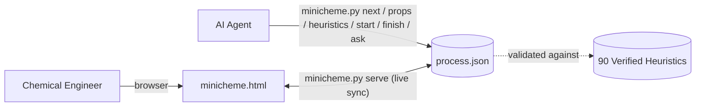

# 🧪 Minicheme: Conceptual Chemical Process Planning Environment

> **Philosophy**:  
> *"When facing a chemical process design from scratch, it is tempting to immediately open a simulator and start guessing what works. Pen, paper, and physical intuition are the true starting points for sound engineering. Minicheme structures the design hierarchy, automates pure-component data retrieval, and grounds every screening decision in verified heuristics—ordering the mind before Aspen Plus, HYSYS, or DWSIM is ever opened."*
>
> **The Golden Heuristic**:  
> *"Never use a heuristic rule unless you understand where it came from and how it was derived."*  
> — *Turton et al., adapted from B. V. Koen*

---

## ✨ How Minicheme 2.0 Works

Inspired by [Kanvas](https://github.com/XMihura/Kanvas), Minicheme runs on **one JSON file (`process.json`), one Python CLI/server (`minicheme.py`), and one self-contained HTML page (`minicheme.html`)** — zero Obsidian, zero build step, zero frontend dependencies.



### Key Capabilities
1. **Interactive Browser Visualization (No Obsidian)**:
   - **Graph View**: Douglas synthesis swimlanes (`Basis & Properties` → `1. Reactor` → `2. Separation` → `3. Heat Exchangers` → `4. Conceptual Brief`) laid out by dependency depth, with lineage highlighting, pan/zoom, drag-to-connect dependencies, and light/dark themes.
   - **Board View**: Kanban state columns (`Proposed`, `Blocked`, `Ready`, `Doing / Waiting`, `Review`, `Done`) with drag-and-drop and one-click review progression.
   - **Substances & Basis View**: Editable Basis of Design, pure-component property table (`chemicals` + PubChem), and an SVG **Normal Boiling Point / Relative Volatility Ladder**.
   - **Heuristics Explorer**: Click any heuristic badge (`REACT-004`, `DIST-002`, `HEX-007`) to read its full textbook derivation, quantitative guidelines, and limitations.
2. **Token-Optimized Agent Workflow**:
   - Agents **never** read the 193 KB `heuristics.json` directly or edit `process.json` by hand.
   - `python minicheme.py next -p <folder>` delivers the exact next ready block, compact upstream parameters, and verified relevant heuristics in **~300 tokens**.
   - `finish` enforces concrete deliverables (`proposal`, `rationale`, `parameters`, verified `heuristics`), rejects hallucinated heuristic IDs, and auto-hydrates textbook citations from `resources/heuristics/heuristics.json`.
3. **Human-in-the-Loop Control & YOLO Mode**:
   - **Strict Douglas Gating**: `{Separation}` stays blocked until `{Reactor}` is done; `{Heat Exchangers}` stays blocked until `{Separation}` is done.
   - **`ask` Gate (`[INFORMATION REQUIRED]`)**: When kinetics, conversion, or specs are missing, the agent pauses the card with a **Waiting for you** alert and browser notification instead of guessing.
   - **Review or YOLO**: Review each completed block (Mark done / Send back with feedback), or enable **YOLO up to `SM-01`** so the agent solves the chain end-to-end and comes back for one unified review at the Conceptual Brief.

---

## 📁 Repository Structure

```
minicheme/
├── minicheme.py                          # Zero-dependency CLI, heuristics query engine, live server & exporter
├── minicheme.html                        # Self-contained interactive HTML board (Graph, Board, Substances, Rules)
├── AGENTS.md                             # Concise agent entrypoint (plus CLAUDE.md / GEMINI.md pointers)
├── .agents/skills/minicheme/SKILL.md     # Token-optimized agent operating manual
├── resources/
│   └── heuristics/
│       ├── heuristics.json               # Master database (90 verified rules, 13 families)
│       ├── pubchem_fetcher.py            # Fast property retriever (chemicals library + PubChem fallback)
│       └── Rules and intuition for process design.md
├── Example1/                             # Complete solved showcase (Green MTBE Production)
│   ├── process.json                      # Canonical process state (10/10 blocks done)
│   ├── Process Summary.md                # Exported Markdown conceptual brief
│   ├── Process design.md                 # Original problem statement
│   └── references/                       # Benchmark patents / commercial reports
├── Example2/                             # Clean unsolved workspace ready for an agent run
├── Process_1/                            # Migrated MTBE workspace
└── tests/
    └── test_minicheme.py                 # Automated unit, parity & live-server test suite
```

---

## 🚀 Quick Start

### 1. Open the Live HTML Board
```powershell
python minicheme.py serve
```
Your browser opens directly to the interactive board with all discovered workspaces (`Example1`, `Example2`, `Process_1`) in the top-left process switcher. Changes from your AI agent appear live within ~1 second, and edits you make in the browser save atomically to `process.json`.

### 2. Create a New Process Workspace
From the browser (**Process menu → + New Chemical Process**) or via CLI:
```powershell
python minicheme.py init Process_Methanol --title "Green Methanol Synthesis" --desc "CO2 + 3 H2 -> CH3OH + H2O, 50,000 t/yr, 99.85 wt% spec"
```
Add `--yolo` if you want the agent to solve all upstream blocks automatically and pause for review at `SM-01` (Conceptual Process Brief).

### 3. Run Your AI Agent
Prompt any coding agent (Antigravity, Claude Code, Codex, Cursor, Gemini CLI):
> *"Follow `AGENTS.md` and execute the Minicheme workflow for `Example2/`."*

The agent follows a deterministic, token-minimal CLI loop:
```powershell
python minicheme.py next -p Example2
python minicheme.py start BP-01 -p Example2 -m "Plan: classify capacity and extract specs"
python minicheme.py basis -p Example2 --capacity "10,000 t/yr" --mode "Continuous" ...
python minicheme.py props "Isobutylene:Reactant" "Methanol:Feed" "MTBE:Product" "Water:Solvent" --thermo "NRTL-RK" -p Example2
python minicheme.py finish BP-01 -p Example2 --json-file payload.json
```

### 4. Export a Portable Brief
```powershell
python minicheme.py export -p Example1                # Standalone read-only HTML snapshot
python minicheme.py export -p Example1 --md           # Clean Markdown Conceptual Process Brief
```

---

## 🛠️ CLI Reference

| Command | Purpose |
| :--- | :--- |
| `init DIR [--title T] [--desc D] [--yolo]` | Scaffold a new Douglas-hierarchy `process.json` workspace |
| `serve [DIR] [--port 8766]` | Launch live multi-process HTML interface in the browser |
| `next [-p DIR]` | Token-optimized agent briefing (~300 tokens): next block, upstream params, heuristics |
| `status [-p DIR]` | Compact overview by state (waiting, doing, review, ready, blocked, done) |
| `show ID [-p DIR]` | Detailed view of one block |
| `heuristics [ID ...] [--search Q] [--family F] [--block ID]` | Compact lookup of the 90 verified engineering heuristics |
| `props COMP1 COMP2 ... [--thermo M] [-p DIR]` | Fetch pure-component properties (`chemicals` + PubChem) into `process.json` |
| `basis [--capacity ...] [--mode ...] [-p DIR]` | Update structured Basis of Design fields |
| `start ID [-m PLAN]` | Move a ready block to `doing` (enforces Douglas dependency gates) |
| `ask ID QUESTION [--missing P] [--why W] [--baseline B]` | Pause with `[INFORMATION REQUIRED]` until the engineer replies |
| `answer ID TEXT` / `note ID TEXT` | Record human reply or engineering note |
| `finish ID --json-file FILE` (or `--stdin`) | Submit concrete `proposal`, `rationale`, `parameters`, and verified `heuristics` |
| `accept ID [--send-back FEEDBACK]` | Human CLI shortcut to accept (`done`) or send back with feedback |
| `yolo ID [--before \| --off]` | Toggle YOLO autonomous chain up to (or stopping before) a block |
| `propose STAGE TITLE [OBJ] [--deps ...]` | Propose an additional custom block |
| `depend ID ON ...` | Add dependency edges (rejects cycles) |
| `check [-p DIR]` | Validate schema, cycle-free DAG, and heuristic citations |
| `export [OUT] [--md]` | Export standalone read-only HTML snapshot or Markdown brief |
| `migrate OLD_DIR` | Migrate a legacy Obsidian Minicheme folder to `process.json` |

---

## 🧪 Running Tests

```powershell
python -m unittest discover -s tests -v
```

---

## 📚 Knowledge Engine Sources

All 90 heuristics in `resources/heuristics/heuristics.json` are compiled from primary chemical engineering literature:
* **Turton et al. (4th Ed.)** — *Analysis, Synthesis, and Design of Chemical Processes* (Douglas 5-level hierarchy, Ch. 2 & 11, PAR method)
* **Seider, Seader, & Lewin (3rd/4th Ed.)** — *Product and Process Design Principles* (Table 6.2 Heuristics 1–53)
* **Ulrich & Vasudevan (2004/2006)** — *Chemical Engineering Design, Appendix C: Rules of Thumb*
* **Sinnott & Towler (2nd Ed.)** — *Chemical Engineering Design*
* **Walas (1988) & Branan (1998)** — *Chemical Process Equipment & Rules of Thumb for Chemical Engineers*
