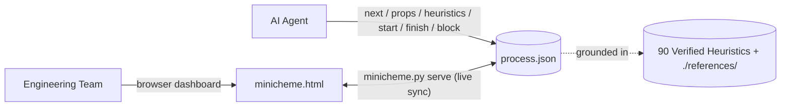

# 🧪 Minicheme: Conceptual Chemical Process Dashboard

> **Philosophy**:  
> *"When facing a chemical process design from scratch, it is tempting to immediately open a simulator and start guessing what works. Pen, paper, and physical intuition are the true starting points for sound engineering. Minicheme structures the design hierarchy, automates pure-component data retrieval, and grounds every unit block in verified heuristics and the user's bibliography—giving the engineering team an easy-to-access dashboard of what to find in the process before Aspen Plus, HYSYS, or DWSIM is ever opened."*
>
> **The Golden Heuristic**:  
> *"Never use a heuristic rule unless you understand where it came from and how it was derived."*  
> — *Turton et al., adapted from B. V. Koen*

---

## ✨ How Minicheme Works

Inspired by [Kanvas](https://github.com/XMihura/Kanvas), Minicheme runs on **one JSON file (`process.json`), one Python CLI/server (`minicheme.py`), and one self-contained HTML dashboard (`minicheme.html`)** — zero Obsidian, zero build step, zero frontend dependencies.



### Traffic-Light Sequential Workflow (Red → Blue → Green)
The agent works through Douglas's hierarchy strictly in order (`BP-01` → `BP-02` → `RX-01..03` → `SP-01..02` → `HX-01..02` → `SM-01`), documenting **what the engineering team will find in each unit** strictly from the user's problem statement, `./references/` bibliography, physical properties, and verified heuristics—**never proposing or inventing process decisions**:

- 🔴 **Red (`pending` / `locked` / `blocked`)**:
  - **Pending**: Ready for the agent to analyze.
  - **Locked**: Waiting on an upstream Douglas block to turn Green.
  - **Blocked (`[INFORMATION REQUIRED]`)**: Information is missing from the user's input and bibliography. The agent leaves the block **Red & Blocked** and stops until the engineering team supplies the missing data.
- 🔵 **Blue (`processing`)**: The agent is actively working on this block.
- 🟢 **Green (`solved`)**: Grounded conceptual findings, parameters, first-principles rationale, and verified heuristic citations are complete, automatically unlocking the next Douglas block in order.

### Key Capabilities
1. **Interactive Engineering Dashboard (No Obsidian)**:
   - **Graph View**: Douglas synthesis swimlanes (`Basis & Properties` → `1. Reactor` → `2. Separation` → `3. Heat Exchangers` → `4. Conceptual Brief`) laid out by dependency depth, with Red/Blue/Green status indicators, lineage highlighting, pan/zoom, drag-to-connect dependencies, and light/dark themes.
   - **Board View**: Status columns (`Blocked — Info Required`, `Pending (Ready)`, `Locked (Upstream)`, `Processing`, `Solved`) with drag-and-drop and one-click unblock/reopen actions.
   - **Substances & Basis View**: Editable Basis of Design, pure-component property table (`chemicals` + PubChem), and an SVG **Normal Boiling Point / Relative Volatility Ladder**.
   - **Heuristics Explorer**: Click any heuristic badge (`REACT-004`, `DIST-002`, `HEX-007`) to read its full textbook derivation, quantitative guidelines, and limitations.
2. **Token-Optimized Agent Loop**:
   - Agents **never** read the 193 KB `heuristics.json` directly or edit `process.json` by hand.
   - `python minicheme.py next -p <folder>` delivers the exact next ready block, compact upstream parameters, and verified relevant heuristics in **~300 tokens**.
   - `finish` enforces concrete deliverables (`findings`, `rationale`, `parameters`, verified `heuristics`), rejects hallucinated heuristic IDs, and auto-hydrates textbook citations from `resources/heuristics/heuristics.json`.
3. **Engineering Team Control**:
   - **Strict Douglas Gating**: `{Separation}` stays Red (Locked) until `{Reactor}` is Green (Solved); `{Heat Exchangers}` stays Locked until `{Separation}` is Solved.
   - **Missing-Info Halt (`block`)**: When kinetics, conversion, feed composition, or specs are missing, the agent marks the card **🔴 Red & Blocked** with a browser alert instead of guessing or proposing arbitrary decisions.
   - **Inline Unblock & Reopen**: Engineers can supply missing data directly in the browser (`Provide Info`) or reopen any Green block (`Reopen for re-evaluation`) whenever new bibliography or constraints arrive.

---

## 📁 Repository Structure

```
minicheme/
├── minicheme.py                          # Zero-dependency CLI, heuristics query engine, live server & exporter
├── minicheme.html                        # Self-contained interactive HTML dashboard (Graph, Board, Substances, Rules)
├── AGENTS.md                             # Concise agent entrypoint (plus CLAUDE.md / GEMINI.md pointers)
├── .agents/skills/minicheme/SKILL.md     # Token-optimized agent operating manual
├── resources/
│   └── heuristics/
│       ├── heuristics.json               # Master database (90 verified rules, 13 families)
│       ├── pubchem_fetcher.py            # Fast property retriever (chemicals library + PubChem fallback)
│       └── Rules and intuition for process design.md
├── Example1/                             # Complete solved showcase (Green MTBE Production — 10/10 Green)
│   ├── process.json                      # Canonical process state
│   ├── Process Summary.md                # Exported Markdown conceptual brief
│   ├── Process design.md                 # Original problem statement
│   └── references/                       # Benchmark patents / commercial reports
├── Example2/                             # Clean unsolved workspace ready for an agent run (all Red)
├── Process_1/                            # Migrated MTBE workspace
└── tests/
    └── test_minicheme.py                 # Automated unit, parity & live-server test suite
```

---

## 🚀 Quick Start

### 1. Open the Live HTML Dashboard
```powershell
python minicheme.py serve
```
Your browser opens directly to the interactive dashboard with all discovered workspaces (`Example1`, `Example2`, `Process_1`) in the top-left process switcher. Changes from your AI agent appear live within ~1 second, and edits you make in the browser save atomically to `process.json`.

### 2. Create a New Process Workspace
From the browser (**Process menu → + New Chemical Process**) or via CLI:
```powershell
python minicheme.py init Process_Methanol --title "Green Methanol Synthesis" --desc "CO2 + 3 H2 -> CH3OH + H2O, 50,000 t/yr, 99.85 wt% spec"
```
Place any relevant literature, patents, or process reports inside `<folder>/references/`.

### 3. Run Your AI Agent
Prompt any coding agent (Antigravity, Claude Code, Codex, Cursor, Gemini CLI):
> *"Follow `AGENTS.md` and execute the Minicheme workflow for `Example2/`."*

The agent runs sequentially through Douglas's hierarchy:
```powershell
python minicheme.py next -p Example2
python minicheme.py start BP-01 -p Example2 -m "Plan: extract capacity, operating mode, and specs from input/references"
python minicheme.py basis -p Example2 --capacity "10,000 t/yr" --mode "Continuous" ...
python minicheme.py props "Isobutylene:Reactant" "Methanol:Feed" "MTBE:Product" "Water:Solvent" --thermo "NRTL-RK" -p Example2
python minicheme.py finish BP-01 -p Example2 --json-file payload.json
# Or, if critical data is missing:
python minicheme.py block RX-01 -p Example2 "Conversion and catalyst data not found in bibliography." --missing "Single-pass conversion" --why "Required to evaluate reactor thermal duty"
```

### 4. Export a Portable Brief
```powershell
python minicheme.py export -p Example1                # Standalone read-only HTML snapshot
python minicheme.py export -p Example1 --md           # Clean Markdown Conceptual Process Brief
```

---

## 🛠️ CLI Reference

| Command | Purpose |
| :--- | :--- |
| `init DIR [--title T] [--desc D]` | Scaffold a new Douglas-hierarchy `process.json` workspace (all blocks 🔴 Red) |
| `serve [DIR] [--port 8766]` | Launch live multi-process HTML dashboard in the browser |
| `next [-p DIR]` | Token-optimized agent briefing (~300 tokens): next ready block, upstream params, heuristics |
| `status [-p DIR]` | Compact overview by status (blocked, processing, pending, locked, solved) |
| `show ID [-p DIR]` | Detailed view of one block |
| `heuristics [ID ...] [--search Q] [--family F] [--block ID]` | Compact lookup of the 90 verified engineering heuristics |
| `props COMP1 COMP2 ... [--thermo M] [-p DIR]` | Fetch pure-component properties (`chemicals` + PubChem) into `process.json` |
| `basis [--capacity ...] [--mode ...] [-p DIR]` | Update structured Basis of Design fields |
| `start ID [-m PLAN]` | Move a ready block to 🔵 `processing` (enforces Douglas dependency gates) |
| `block ID QUESTION [--missing P] [--why W] [--baseline B]` | Mark a block 🔴 Red & Blocked (`[INFORMATION REQUIRED]`) when required info is missing (alias: `ask`) |
| `provide ID TEXT` | Supply missing information from the engineering team to unblock a Red block (alias: `answer`) |
| `finish ID --json-file FILE` (or `--stdin`) | Record grounded `findings`, `rationale`, `parameters`, and verified `heuristics` → 🟢 `solved` |
| `reopen ID [-m FEEDBACK]` | Reopen a Green block back to 🔴 `pending` for re-evaluation |
| `note ID TEXT` | Append an engineering note to a block |
| `depend ID ON ...` | Add dependency edges (rejects cycles) |
| `check [-p DIR]` | Validate schema, cycle-free DAG, and heuristic citations |
| `export [OUT] [--md]` | Export standalone read-only HTML snapshot or Markdown brief |
| `migrate OLD_DIR` | Migrate a legacy Obsidian Minicheme folder to `process.json` |

---

## 🧪 Running Tests

```powershell
python -m unittest discover -s tests -v
```

---

## 📚 Knowledge Engine Sources

All 90 heuristics in `resources/heuristics/heuristics.json` are verified against primary chemical engineering literature:
* **Turton et al. (4th Ed.)** — *Analysis, Synthesis, and Design of Chemical Processes* (Douglas 5-level hierarchy, Ch. 2 & 11, PAR method)
* **Seider, Seader, & Lewin (3rd/4th Ed.)** — *Product and Process Design Principles* (Table 6.2 Heuristics 1–53)
* **Ulrich & Vasudevan (2004/2006)** — *Chemical Engineering Design, Appendix C: Rules of Thumb*
* **Sinnott & Towler (2nd Ed.)** — *Chemical Engineering Design*
* **Walas (1988) & Branan (1998)** — *Chemical Process Equipment & Rules of Thumb for Chemical Engineers*
