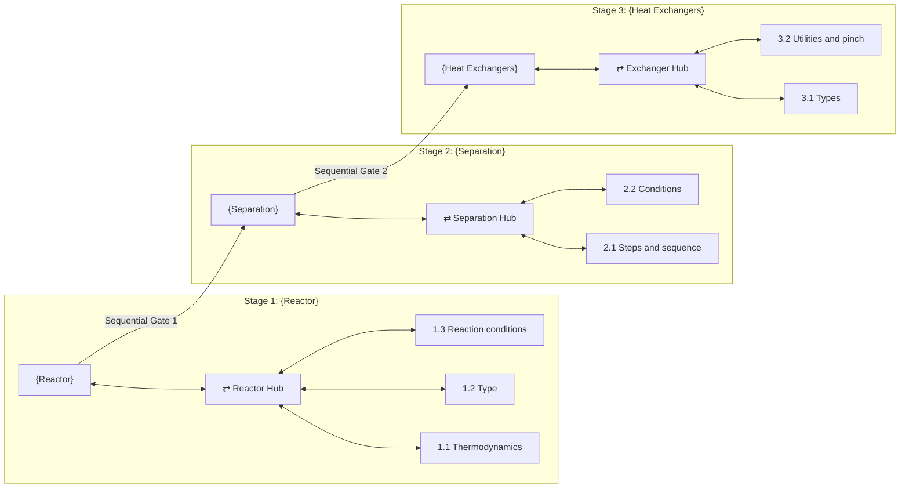

# 🧪 Minicheme: Conceptual Chemical Process Planning Environment

> **Philosophy**:  
> *"When facing a chemical process design from scratch, it is tempting to immediately open a simulator and start guessing what works. However, pen, paper, and physical intuition are the true starting points for sound engineering. Minicheme automates data retrieval, structures the design hierarchy, and grounds every decision in verified heuristics—ordering the mind before a simulator is ever opened."*
>
> **The Golden Heuristic**:  
> *"Never use a heuristic rule unless you understand where it came from and how it was derived."*  
> — *Turton et al., adapted from B. V. Koen*

---

## 🧭 Core Purpose & Vision

Modern chemical engineers frequently fall into the **"Simulator Trap"**: jumping straight into commercial software (Aspen Plus, Aspen HYSYS, DWSIM) before establishing the basic chemical and physical fundamentals of the process. This leads to:
* Trial-and-error flowsheeting with unphysical recycle loops.
* Unconverged flash blocks and runaway numerical iterations.
* Massive time lost hunting down physical properties (molecular weights, boiling points, azeotropes, viscosities).
* Blind reliance on software defaults without understanding governing trade-offs.

**Minicheme** provides an autonomous, Obsidian-native conceptual design environment. It sits upstream of process simulators:
1. **Structures the Engineer’s Thinking**: Employs Douglas’s 5-level hierarchy of process synthesis ({Reactor} $\to$ {Separation} $\to$ {Heat Exchangers}).
2. **Automates Chemical Data Retrieval**: Powered by the Python **`chemicals` library** (DIPPR, Perry's Handbook, NIST) with **PubChem API** fallback to retrieve compound formulas, boiling/melting points, critical constants ($T_c, P_c, \omega$), densities, viscosities, and vapor pressures with zero manual scraping.
3. **Visualizes Hierarchies in Obsidian Canvas**: Embeds unit operation sub-modules into an interactive, color-coded state machine (`Unit operations.canvas`).
4. **Justifies Every Decision with Verified Heuristics**: Compiles 90+ verified rules of thumb from primary literature (Turton, Seider, Ulrich & Vasudevan, Walas, Sinnott & Towler) into queryable JSON and Markdown tables.
5. **Enforces Human-in-the-Loop Integrity**: If critical kinetic or thermodynamic data is missing, the agent halts, highlights the affected module in red, and asks the engineer for clarification instead of hallucinating values.

---

## 🎯 Who Is Minicheme For?

* **Process Design Students & Capstone Teams**: Structure senior plant design projects cleanly, avoiding chaotic flowsheets and grounding preliminary equipment choices in literature heuristics.
* **Conceptual Process Engineers (EPC / Chemical Industry)**: Rapidly formulate and screen preliminary design concepts, evaluate batch vs. continuous feasibility, and establish the Basis of Design.
* **R&D Chemists & Tech Transfer Teams**: Bridge laboratory synthesis routes with commercial process engineering, predicting required separations, quench requirements, and solvent recycle strategies.
* **Plant & Debottlenecking Engineers**: Evaluate unit operation capacity modifications using rule-of-thumb sizing equations before commissioning detailed simulation studies.

---

## 📁 Repository Structure

```
minicheme/
├── README.md                                    <-- You are here (Quickstart & User Guide)
│
├── resources/                                   <-- Central Knowledge & Tooling Engine (Shared)
│   └── heuristics/
│       ├── heuristics.json                      <-- Master JSON database (90 rules, 13 families)
│       ├── Rules and intuition for process design.md <-- Detailed engineering handbook
│       ├── pubchem_fetcher.py                   <-- Fast thermodynamic property retriever (chemicals + PubChem)
│       ├── agents.md                            <-- Operating rules for heuristics retrieval skill
│       └── gemini.md                            <-- Operating rules for heuristics retrieval skill
│
├── Process_template/                            <-- Master blueprint folder for new processes
│   ├── references/                              <-- Local process references (patents, papers, benchmark PFDs)
│   ├── gemini.md / agents.md                    <-- Autonomous agent operating instructions
│   ├── Process design.md                        <-- User process input file
│   ├── Chemical substances.md                   <-- Auto-populated compound property table
│   ├── Unit operations.canvas                   <-- Visual hierarchical canvas template
│   └── [1.1 to 3.2 Submodule Notes]             <-- Pre-linked Markdown design notes
│
└── Process_1/                                   <-- First active sandbox / process workspace
    └── (Identical structure to Process_template)
```

---

## 🚀 How to Use Minicheme (Step-by-Step)

### Step 1: Create a New Process Workspace
To start designing a new chemical process, simply duplicate `Process_template` and rename it to your project name (e.g. `Process_Biodiesel`, `Process_Methanol`, or `Process_2`):
```powershell
Copy-Item -Recurse Process_template Process_2
```

---

### Step 2: Describe Your Target Process
Open `Process design.md` inside your new process folder and write a free-text description of your desired chemical process:
* **Target Chemistry**: Key reaction equation(s), catalysts, desired product, and known byproducts.
* **Feedstocks & Solvents**: Raw material inputs, proposed solvents, or carrier gases.
* **Operating Scale**: Target annual production (e.g. $50,000\text{ metric tons/year}$).
* **Specific Constraints**: Known thermal sensitivities, desired conversions, or purity specs.

*(Optional)* If you have patent abstracts, flowsheets, or research papers from similar chemistries, place them in your project's local `references/` folder to give the AI agent extra benchmarking context.

---

### Step 3: Trigger the Minicheme Agent
In your AI pair programming environment (Antigravity / Gemini), prompt the agent:
> *"I have filled out `Process design.md` in `Process_2/`. Please execute the Minicheme workflow."*

The agent will read its local operating manual (`gemini.md` / `agents.md`) and autonomously execute the design protocol.

---

### Step 4: Automated Chemical Property Retrieval
The agent executes `resources/heuristics/pubchem_fetcher.py`, powered by the `chemicals` library with PubChem fallback:
```powershell
python ../resources/heuristics/pubchem_fetcher.py Reactant1 Product1 Solvent1 --out "Chemical substances.md"
```
Within milliseconds, `Chemical substances.md` is populated with a comprehensive reference table:
* Molecular weight (MW), chemical formula, and CAS / PubChem identifiers.
* Normal boiling point ($T_b$) and melting point ($T_m$).
* Critical temperature ($T_c$), critical pressure ($P_c$), and acentric factor ($\omega$).
* Liquid density ($\rho$) and viscosity ($\mu$) at $25^\circ\text{C}$.
* Vapor pressure ($P^{\text{sat}}$ at $25^\circ\text{C}$).
* Automated relative volatility ranking ($\alpha$) and boiling point ordering to guide downstream column sequencing.

---

### Step 5: Hierarchical Obsidian Canvas Execution
Open `Unit operations.canvas` inside Obsidian. You will see the visual process layout:



#### Canvas Rules & Conventions:
1. **Color Status System**:
   * 🔴 **Red (`"1"`)**: Unsolved / Pending / Blocked / Missing Information.
   * 🔵 **Blue (`"5"`)**: Actively Processing.
   * 🟢 **Green (`"4"`)**: Solved, validated, and justified with heuristics.
2. **Strict Hierarchy**:
   * `{Separation}` is **locked** until `{Reactor}` is completely **Green**.
   * `{Heat Exchangers}` is **locked** until `{Separation}` is completely **Green**.
3. **Sub-Modules as Embedded Notes**:
   * Each sub-module card on the canvas is a direct Obsidian `.md` file node (e.g. `1.1 Reactor - Thermodynamics.md`).
   * Clicking or zooming into a node reveals the technical proposal, governing equations, and heuristics table written directly inside that note!

---

### Step 6: The Human-in-the-Loop "While Loop"
Heuristics cannot operate on guesswork. If your process description lacks essential engineering data (e.g., unknown conversion, missing reaction heat, uncharacterized side reactions):
1. **The agent will NOT invent or hallucinate numbers.**
2. The affected sub-module remains **Red (`"1"`)**.
3. The agent inserts an **`[INFORMATION REQUIRED]`** callout block directly into the note and chat:
   ```markdown
   > [!WARNING] INFORMATION REQUIRED FROM USER
   > **Missing Parameter**: Reaction single-pass conversion target.
   > **Why it is needed**: Required to size the recycle loop and determine raw material excess.
   > **Recommended Baseline**: Literature typically reports 65-75% per-pass conversion for this catalyst.
   ```
4. The parent stage remains locked until you reply or update `Process design.md`. Once clarified, the agent resumes, marks the note **Green**, and unlocks the next stage.

---

### Step 7: Heuristics Justification & Final Transition
Every solved note includes a verified **Heuristics Table** cross-referencing `resources/heuristics/heuristics.json`:

| Heuristic ID | Rule Summary | Parameters / Equations | Primary Citation |
| :--- | :--- | :--- | :--- |
| `REACT-003` | CSTR vs PFR volume comparison | Positive order kinetics $\to$ PFR requires smaller volume | Ulrich (2004) p. 581 |
| `DIST-002` | Distillation column sequencing | Easiest separation first ($\alpha > 2.0$), corrosive species early | Turton Table 11.13 |
| `DIST-004` | Economic reflux ratio | Set $R = 1.2 \text{ to } 1.3 R_{\min}$ | Seider Heuristic 9 |
| `HEX-001` | Shell-and-tube geometry standards | $3/4''$ OD on $1''$ triangular pitch, $16\text{ ft}$ length | Walas / Turton Table 11.11 |

When all modules turn **Green (`"4"`)**, conceptual planning is complete. You now possess a structured chemical basis, verified equipment types, and preliminary sizing parameters, allowing you to build your Aspen Plus, HYSYS, or DWSIM model in a fraction of the time.

---

## 📚 The Minicheme Knowledge Engine

All heuristics compiled in `resources/heuristics/heuristics.json` ($200.9\text{ KB}$, 90 rules) and explained in `Rules and intuition for process design.md` ($34.6\text{ KB}$) are derived from primary chemical engineering literature:

* **Turton et al. (4th Edition)**: *Analysis, Synthesis, and Design of Chemical Processes* (Douglas 5-level synthesis hierarchy, Chapters 2 & 11, Tables 11.1–11.18, and the PAR methodology).
* **Seider, Seader, & Lewin (3rd/4th Edition)**: *Product and Process Design Principles* (Table 6.2 Heuristics 1–53 across reaction, separation, phase control, and solids).
* **Ulrich & Vasudevan (2004/2006)**: *Chemical Engineering Design, Appendix C: Rules of Thumb* (Verified equipment scaling equations, HETP correlations, vaporizer velocity, and mixer power).
* **Sinnott & Towler (2nd Edition)**: *Chemical Engineering Design* (Chapter 1: Basis of Design, overdesign factors, documentation hierarchy BFD $\to$ PFD $\to$ P&ID, and ASME/API codes).
* **Walas & Branan**: *Chemical Process Equipment & Rules of Thumb for Chemical Engineers* (Practical field bounds, vessel holdups, and piping hydraulics).

---

## 💡 Quick Tips for Obsidian Users

* **Canvas Navigation**: Use `Spacebar + Drag` to pan across the canvas, and `Scroll Wheel` to zoom.
* **Editing Sub-Modules**: Double-click any file node in the canvas to edit its markdown note directly in place.
* **Side-by-Side Viewing**: Open `Unit operations.canvas` on the left pane and `Chemical substances.md` on the right pane for an optimal dual-screen process planning dashboard.
* **Search the Heuristics**: You can search `resources/heuristics/heuristics.json` by keyword, tag (e.g. `reflux drum`, `NPSH`, `pinch`, `fluidized bed`), or equipment family at any time.

---

*Happy Process Designing! Ground your intuition in first principles, and let Minicheme do the heavy lifting.* 🧪📐
