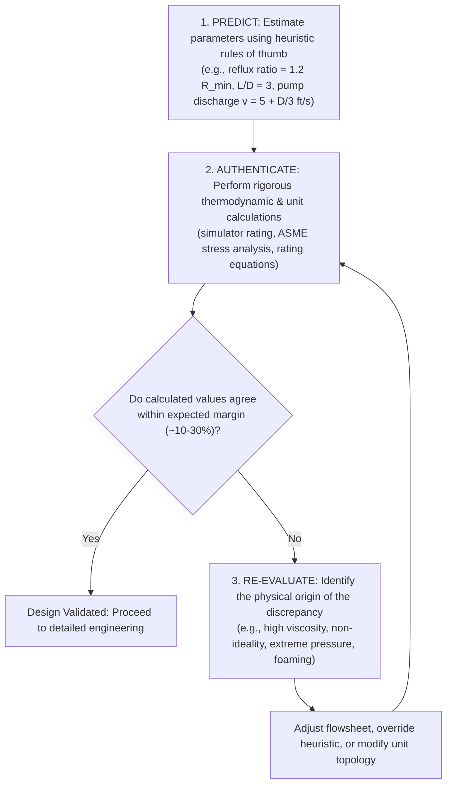
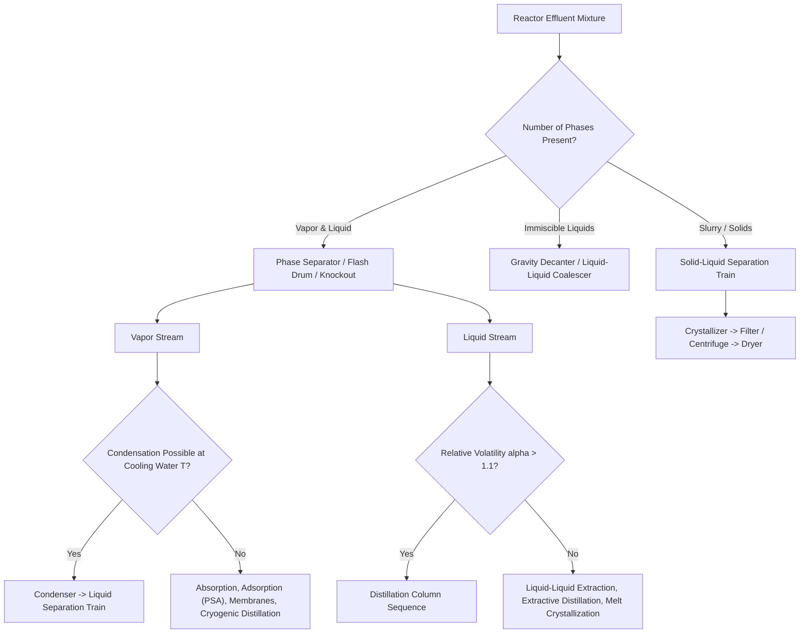

# Rules and Intuition for Process Design: The Minicheme Engineering Handbook

> **The Golden Heuristic**:  
> *"Never use a heuristic rule unless you understand where it came from and how it was derived."*  
> — *Turton et al., based on B. V. Koen (Definition of the Engineering Method)*

---

## 1. Foundational Philosophy & The Engineering Method

### 1.1 Pen & Paper vs. The Simulator Trap
When embarking on a chemical process design from scratch, modern engineers often jump immediately into commercial flowsheeting packages (e.g., Aspen Plus, Aspen HYSYS, DWSIM). While rigorous simulators are powerful, using them prematurely creates a dangerous illusion of accuracy:
1. **Garbage In, Garbage Out**: Simulators converge on non-physical or economically absurd local minima if the underlying flowsheet structure, recycle topology, and property packages are flawed.
2. **Loss of Process Intuition**: Adjusting numbers in a software interface obscures the fundamental thermodynamic trade-offs (e.g., reboiler duty vs. reflux ratio, conversion vs. recycle compression).
3. **First-Principles First**: Preliminary conceptual design must begin with **pen and paper**: establishing the chemistry, mass balances, stoichiometric constraints, phase envelopes, and experienced-based heuristics. Once a rational base case is established, simulation tools serve to refine and authenticate the design.

### 1.2 The PAR Methodology: Predict, Authenticate, Re-Evaluate
Heuristics are condensed empirical guidelines reflecting historical economic optimization (capital cost vs. operating cost at standard utility pricing). Because they are shortcut approximations, they must be validated through the **PAR Process** (Turton et al., Chapter 11):

---

## 2. Douglas & Turton Hierarchy of Process Synthesis

Chemical process design follows a five-level hierarchical decision tree originally formalized by James M. Douglas and expanded by Turton et al. Every complex chemical plant can be decomposed into this structure.

### Level 1: Batch vs. Continuous Processing
The first synthesis decision determines the plant operating mode:
* **Continuous Processing**: Preferred for large production volumes where economies of scale offset higher automation and dedicated piping capital costs.
  * **Threshold**: Annual production $> 5,000\text{ metric tons/year}$ ($\approx 10,000,000\text{ lb/year}$).
  * **Operating Window**: Designed for $7,920 \text{ to } 8,400\text{ hours/year}$ ($330 \text{ to } 350\text{ days/year}$, $90-95\%$ stream factor).
* **Batch Processing**: Preferred for small volumes, multi-product specialty chemicals, pharmaceuticals, and seasonal campaigns.
  * **Threshold**: Annual production $< 500\text{ metric tons/year}$ ($\approx 1,000,000\text{ lb/year}$).
  * **Operating Window**: Typically $6,000 \text{ to } 7,000\text{ hours/year}$.
  * **Key Drivers for Batch**:
    1. *Slow reaction kinetics* requiring long residence times ($> 4-8\text{ hours}$).
    2. *Severe fouling or slurry precipitation* requiring frequent mechanical cleaning or sterilization.
    3. *Regulatory batch integrity* (e.g., FDA requirements for lot traceability in pharmaceuticals).
* **Transition Zone ($500 \text{ to } 5,000\text{ t/year}$)**: Evaluate multi-product campaigns, market volatility, and flexibility before committing to dedicated continuous equipment.

---

### Level 2: Input/Output Structure of the Flowsheet
Analyze the overall plant boundary before detailing internal loops:
1. **Raw Material Purity & Inert Management**:
   * If raw material impurities are inert and easily separated upstream (e.g. relative volatility $\alpha > 3.0$ or simple condensation), remove them **before** the reactor to reduce equipment volume and compression power.
   * **Exception**: Retain gaseous inerts in the feed if the reaction is highly exothermic; the inert acts as an internal heat sink, suppressing the adiabatic temperature rise ($\Delta T_{\text{ad}} = \frac{-\Delta H_{\text{rxn}} \cdot x_{\text{feed}}}{\bar{C}_p}$).
2. **Stoichiometric Reactant Excess**:
   * When one reactant is valuable, toxic, hazardous, or difficult to separate, feed an excess ($5\% \text{ to } 50\%$) of an inexpensive, benign, or volatile co-reactant (e.g., excess air, steam, or light hydrocarbon).
   * By Le Chatelier's principle and forward kinetic rate laws, this forces near $100\%$ consumption of the limiting toxic reactant.
3. **Purge Stream Synthesis**:
   * Any chemical entering the flowsheet (feed impurities) or generated in an irreversible side reaction that is recycled **must have an exit**.
   * Without a purge, non-reactive species accumulate indefinitely.
   * Direct light gaseous species ($\text{H}_2, \text{CH}_4, \text{N}_2$) to a **vapor purge** at the high point of the recycle loop.
   * Direct heavy liquids (oligomers, tars) to a **liquid bottoms purge**.
   * Calculate required purge fraction:
     $$f_{\text{purge}} = \frac{\dot{m}_{\text{impurity, feed}}}{\dot{m}_{\text{impurity, recycle}}}$$
4. **Environmental and Valuable Purge Constraints**:
   * Never vent toxic chemicals, VOCs, or hazardous species directly to atmosphere.
   * If valuable reactants are lost in the purge, install a dedicated recovery separator (membrane, PSA, or scrubber) before venting to a flare or thermal oxidizer ($99\%+$ destruction efficiency).

---

### Level 3: Recycle Structure of the Flowsheet
Address equilibrium, kinetics, and by-product management:
1. **Equilibrium-Limited Reactions**:
   * For reversible reactions ($A + B \rightleftharpoons C$), single-pass conversion is constrained by thermodynamics.
   * Recycle unreacted raw materials back to the reactor inlet.
   * For side-reactions forming by-products reversibly ($A + C \rightleftharpoons D$), **recycle the by-product to extinction**; maintaining equilibrium concentration of $D$ in the feed suppresses its net generation.
2. **Phase of the Recycle Stream**:
   * Increasing pressure in the liquid phase via a pump requires orders-of-magnitude less thermodynamic work ($dW = V dP$) than compressing a gas ($V_{\text{liquid}} \ll V_{\text{gas}}$).
   * If a gas recycle stream can be condensed using standard cooling water ($T_{\text{dew}} > 40^\circ\text{C}$), condense and pump the liquid.
   * If condensation requires deep refrigeration, compare the refrigeration capital and operating cost against the gas compressor power.
3. **Reaction-Separation Coupling**:
   * For equilibrium-limited reactions with compatible boiling points, evaluate **reactive distillation** (e.g., esterifications). Removing products in situ drives conversion beyond thermodynamic limits in a single unit.

---

### Level 4: General Structure of the Separation System
Synthesize the separation train systematically by phase:

#### Distillation Sequencing Heuristics
When arranging a sequence of standard two-product distillation columns to separate $N$ components into $N$ pure streams ($N-1$ columns required), follow these rules of thumb:
1. **Easiest Separation First**: Separate component pairs with the highest relative volatility ($\alpha$) first, requiring the fewest stages and lowest reflux.
2. **Corrosive / Hazardous First**: Remove corrosive, reactive, fouling, or toxic components as early as possible to minimize the use of expensive exotic alloys in downstream columns.
3. **Plentiful Component First**: Remove the component with the highest molar flow rate early to reduce volumetric traffic in all subsequent columns.
4. **Difficult Separation Last**: Reserve separations with low relative volatility ($\alpha < 1.15$) for the end of the train, performing them in the absence of non-key components.
5. **High Purity Last**: Reserve streams requiring ultra-high purity ($> 99.9\%$) for the final columns to minimize product contamination risk.
6. **Favor 50/50 Molal Splits**: Sequences dividing feed into roughly equimolar distillate and bottoms streams ($D/B \approx 0.8 - 1.2$) minimize thermodynamic reboiler irreversibility.

---

### Level 5: Energy Recovery & Pinch Analysis
Integrate heat across process streams before applying external utilities:
1. **The Core Pinch Principle**:
   * *Never transfer heat across the pinch.*
   * Above the pinch: Process acts as a heat sink $\to$ only accept heat from hot utilities (steam, fired heaters).
   * Below the pinch: Process acts as a heat source $\to$ only reject heat to cold utilities (cooling water, air coolers, refrigerants).
2. **Minimum Temperature Approach ($\Delta T_{\min}$)**:
   * Petrochemical / General Chemicals: $\Delta T_{\min} = 10 \text{ to } 20^\circ\text{C}$ ($18 \text{ to } 36^\circ\text{F}$).
   * Cryogenic Gas Processing: $\Delta T_{\min} = 2 \text{ to } 5^\circ\text{C}$ ($3.6 \text{ to } 9^\circ\text{F}$) because refrigeration power is extremely expensive.
   * High-Temperature Flue Gases / Furnaces: $\Delta T_{\min} = 100 \text{ to } 200^\circ\text{C}$.
3. **Utility Cascades**:
   * Match utility temperature levels to process needs: use Low Pressure (LP) steam for low-temperature reboilers rather than degrading High Pressure (HP) steam across a throttling valve.

---

## 3. Sinnott & Towler Design Framework & Practical Engineering

### 3.1 Establishing the Design Basis
Every credible engineering design must begin by fixing the **Basis of Design**:
* **Nameplate Capacity**: Annual output (e.g. $100,000\text{ t/year}$) divided by operating factor:
  $$\text{Hourly Production Rate} = \frac{\text{Annual Capacity}}{\text{Annual Operating Hours}} = \frac{100,000\text{ t}}{8,000\text{ hr}} = 12.5\text{ t/hr}$$
* **Standard Operating Hours**: $8,000\text{ hr/year}$ ($333\text{ days/year}$, $91.3\%$ on-stream factor) is the industry standard for continuous chemical plants; $8,400\text{ hr/year}$ ($96\%$) for world-scale refineries.
* **Feedstock Specifications**: Battery-limit temperature, pressure, phase, and worst-case compositional ranges.
* **Product Specifications**: Sales purity (e.g. $99.5\text{ wt\%}$), maximum allowable moisture (ppm), and toxic contaminant limits.
* **Utility Availabilities**: Cooling water supply temperature (summer peak $30-32^\circ\text{C}$), return limit ($45-49^\circ\text{C}$), available steam header pressures (HP, MP, LP), power supply voltage, instrument air pressure ($3-7\text{ barg}$).
* **Site and Environmental Regulations**: Emissions caps ($\text{NO}_x, \text{SO}_x$, VOCs), wastewater discharge COD/BOD limits, and seismic/wind design standards.

### 3.2 Design Factors and Overdesign Margins
Process equipment must never be sized precisely for nominal average flows; engineering design margins provide resilience against fouling, operational swings, and feed variability:

| Equipment Category | Standard Design Margin (Overdesign Factor) | Rationale |
| :--- | :--- | :--- |
| **Centrifugal Pumps** | $+10\%$ to $+20\%$ on flow rate; $+10\%$ on head | Impeller wear, pipe scale buildup, control valve authority |
| **Heat Exchangers** | $+15\%$ to $+25\%$ excess heat transfer area | Accounts for surface fouling ($R_f$) between turnaround cleanings |
| **Fired Furnaces** | $+10\%$ to $+15\%$ on thermal design duty | Burner coking, soot deposition on convection tubes |
| **Distillation Columns** | $+10\%$ to $+20\%$ on vapor/liquid cross-sectional capacity | Column operation designed at $75-80\%$ of jet flooding |
| **Pressure Vessels (Drums)** | Design pressure: $+10\%$ or $+10-25\text{ psi}$ ($0.7-1.7\text{ bar}$) above max operating | Prevents nuisance relief valve lifting during pressure surges |
| **Pressure Vessels (Temp)** | Design temp: $+25^\circ\text{C}$ ($+50^\circ\text{F}$) above max operating | Protects allowable metal stress under ASME Boiler & PV Code |

### 3.3 Documentation Hierarchy in Chemical Projects
Engineering deliverables follow a strict progressive maturation sequence:
1. **Block Flow Diagram (BFD)**: Conceptual blocks showing overall mass balances and key synthesis steps.
2. **Process Flow Diagram (PFD)**: Displays all major process equipment, control loops, and the complete **Heat & Mass Balance (H&MB)** stream table (temperature, pressure, vapor fraction, mass/molar flows, compositions).
3. **Piping & Instrumentation Diagram (P&ID)**: The construction blueprint showing all pipe lines (sizes, materials, insulation), control valves, manual block valves, bypasses, drain vents, safety relief valves (PSVs), and instrument transmitters/interlocks.
4. **Equipment Specification Data Sheets**: Detailed mechanical and process datasheets for vendor procurement (ASME code ratings, metallurgy, nozzles, pump curves, motor frames).

---

## 4. Deep-Dive Heuristics & Quantitative Rules by Family

### 4.1 Reactors and Kinetics
* **Residence Times**:
  * Liquid-phase CSTRs: 10 minutes to 4 hours.
  * Gas-phase tubular reactors: 0.1 to 10 seconds.
  * Space velocity: Gas Hourly Space Velocity (GHSV) $= 500 \text{ to } 10,000\text{ hr}^{-1}$; Liquid Hourly Space Velocity (LHSV) $= 0.5 \text{ to } 5.0\text{ hr}^{-1}$.
* **Reactor Types**:
  * PFR provides smaller volume than CSTR for positive-order reactions ($n > 0$).
  * A cascade of 3 to 4 CSTRs in series achieves $80-90\%$ of PFR conversion while retaining agitation and heat transfer capabilities.
* **Thermal Management**:
  * Severe exotherms: Cold-shot fluid injection, inert diluent, or excess reactant.
  * Moderate exotherms: External pump-around cooler, jacket (limited to $V < 15-20\text{ m}^3$), or internal coils.
* **Catalyst Particle Sizes**:
  * Fluidized bed reactors: $\sim 0.10\text{ mm}$ ($100\ \mu\text{m}$, Geldart Group A/B).
  * Slurry bubble columns: $\sim 1.0\text{ mm}$.
  * Fixed packed bed reactors: $2 \text{ to } 5\text{ mm}$ ($1/8'' \text{ to } 3/16''$ pellets or extrudates) to avoid excessive pressure drop ($\Delta P < 0.2\text{ bar/m}$).
* **Fluid Bed Geometry**: Uniform temperature within $5^\circ\text{C}$; well-stirred when $L/D < 2$; plug flow when $L/D > 4$. Packed bed height must satisfy $H \ge 0.5 D$ to ensure uniform flow distribution.

---

### 4.2 Distillation and Absorption Columns
* **Operating Pressure**:
  * Set at lowest feasible pressure; condenser bubble point $\ge 40-49^\circ\text{C}$ ($104-120^\circ\text{F}$) using cooling water.
  * Bottoms reboiler temperature limited to prevent thermal decomposition or coking.
* **Reflux & Stages**:
  * Operating reflux ratio: $R = 1.1 \text{ to } 1.5 R_{\min}$ (economic optimum: $1.2 \text{ to } 1.3 R_{\min}$).
  * Operating stages: $N = 1.5 \text{ to } 2.0 N_{\min}$.
  * Maximum theoretical stages in a single column shell $\approx 80 - 100$ trays; split into two shells if exceeded to prevent excessive tower height ($> 50-60\text{ m}$).
* **Trays vs. Packing**:
  * Use **Trays** for: $D > 0.9\text{ m}$ ($3\text{ ft}$), high liquid rates, fouling/slurries, internal cooling coils.
  * Use **Packing** for: Vacuum distillation (low $\Delta P$), corrosive fluids (ceramic/plastic packings), small diameters ($D < 0.6\text{ m}$), foaming systems.
* **Tray Column Equations (Ulrich Verified)**:
  $$H_a = \frac{N \cdot H_t}{\epsilon_t}$$
  $$\text{Stage height } H_t = 0.5 D^{0.3} \quad (D > 1.0\text{ m}); \quad H_t = 0.5\text{ m} \quad (D \le 1.0\text{ m})$$
  * Standard tray spacing: $18 \text{ to } 24\text{ inches}$ ($0.45 \text{ to } 0.60\text{ m}$).
  * Tray efficiency: $60\% \text{ to } 85\%$ for light hydrocarbons ($\mu < 0.5\text{ cP}$); $< 30\%$ for viscous liquids ($\mu > 2\text{ cP}$); $25\% \text{ to } 40\%$ for gas absorbers.
  * Pressure drop: $\approx 1\text{ kPa per tray}$ ($0.15\text{ psi/tray}$).
* **Packed Column Equations (Ulrich Verified)**:
  $$H_a = N \cdot \text{HETP}$$
  $$\text{HETP} = 0.5 D^{0.3} \quad (\text{distillation, } D > 0.5\text{ m})$$
  $$\text{HETP} = D^{0.3} \quad (\text{gas absorption, } D > 0.5\text{ m})$$
  $$\text{HETP} = D \quad (\text{both distillation and absorption when } D \le 0.5\text{ m})$$
  * Column/packing diameter ratio: $D / d_p \ge 10 \text{ to } 15$ to eliminate wall bypass channeling.
  * Install liquid redistributors every $4 \text{ to } 6\text{ m}$ ($15 \text{ to } 20\text{ ft}$) of packed bed height.

---

### 4.3 Heat Exchangers, Furnaces & Boilers
* **Standard Shell-and-Tube Geometry**:
  * Tubes: $3/4\text{-inch}$ ($19.05\text{ mm}$) OD on $1\text{-inch}$ ($25.4\text{ mm}$) triangular pitch.
  * Tube lengths: Standard $16\text{ ft}$ ($4.88\text{ m}$) or $20\text{ ft}$ ($6.10\text{ m}$).
  * Surface density: $1\text{-ft}$ ($30\text{ cm}$) shell diameter contains $\approx 100\text{ ft}^2$ ($9.3\text{ m}^2$) of surface area. Area scales approximately with $D_{\text{shell}}^{2.15}$.
* **Fluid Allocation**:
  * **Tube side**: Corrosive fluids, fouling liquids, high pressure ($> 10\text{ bar}$), high temperature, toxic streams.
  * **Shell side**: Viscous fluids, condensing vapors, boiling liquids, low allowable pressure drop streams.
* **Thermal Design Equation**:
  $$A = \frac{\dot{Q}}{U \cdot F \cdot \text{LMTD}}$$
  * Maintain $F \ge 0.80 - 0.90$. If $F < 0.80$, switch to multiple shells in series to eliminate temperature cross.
* **Typical Overall Heat Transfer Coefficients ($U$)**:
  * Water to water: $800 \text{ to } 1,500\text{ W}/(\text{m}^2\cdot\text{K})$ [$140-260\text{ Btu}/(\text{hr}\cdot\text{ft}^2\cdot^\circ\text{F})$].
  * Organic liquid to organic liquid: $200 \text{ to } 500\text{ W}/(\text{m}^2\cdot\text{K})$ [$35-90$].
  * Gas to gas: $15 \text{ to } 50\text{ W}/(\text{m}^2\cdot\text{K})$ [$3-10$].
  * Steam reboilers (boiling water/organics): $1,000 \text{ to } 2,500\text{ W}/(\text{m}^2\cdot\text{K})$ [$175-440$].
  * Condensing steam: $1,500 \text{ to } 3,000\text{ W}/(\text{m}^2\cdot\text{K})$ [$260-530$].
* **Reboiler Nucleate Boiling Limit**:
  * Maintain maximum overall driving force $\Delta T_{\text{driving}} \le 45^\circ\text{F}$ ($25^\circ\text{C}$) to guarantee nucleate boiling and avoid catastrophic film boiling burnout.
* **Fired Furnaces**:
  * Use for process fluid heating above $750^\circ\text{F}$ ($400^\circ\text{C}$).
  * Supply $10-25\%$ excess air; limit firebox temperature to $2,000^\circ\text{F}$ ($1,100^\circ\text{C}$).
  * Keep stack gas temperature $> 300^\circ\text{F}$ ($150^\circ\text{C}$) or $650-950^\circ\text{F}$ without economizers to prevent sulfuric acid dew-point condensation.
* **Exchanger Pressure Drops**:
  * Liquids: $0.2 \text{ to } 0.6\text{ bar}$ ($3 \text{ to } 9\text{ psi}$).
  * Gases / condensing vapors: $0.05 \text{ to } 0.15\text{ bar}$ ($0.7 \text{ to } 2.0\text{ psi}$).
  * Furnace process coils: $1.4\text{ bar}$ ($20\text{ psi}$).

---

### 4.4 Fluid Machinery & Hydraulics
* **Pump Selection**:
  * Centrifugal: $10 \text{ to } 5,000\text{ gpm}$ ($2.3 \text{ to } 1,140\text{ m}^3/\text{h}$), heads up to $3,200\text{ ft}$ ($1,000\text{ m}$).
  * Reciprocating positive displacement: Heads up to $20,000\text{ ft}$ ($6,000\text{ m}$, pressures to $700\text{ bar}$), low flows ($< 500\text{ gpm}$).
  * Rotary / gear: Viscosities $> 200 \text{ to } 100,000\text{ cP}$.
* **Pump Sizing Equations**:
  $$\text{THp} = \frac{\text{gpm} \cdot \Delta P_{\text{psi}}}{1,714} \quad \Longleftrightarrow \quad P\ [\text{kW}] = \frac{1.67 \cdot Q\ [\text{m}^3/\text{min}] \cdot \Delta P\ [\text{bar}]}{\eta}$$
  * Centrifugal efficiency $\eta$: $45\%$ at $20\text{ gpm}$, $70\%$ at $200\text{ gpm}$, $80-85\%$ at $1,000+\text{ gpm}$.
  * Electric motor efficiency: $85\% \text{ to } 95\%$.
* **Net Positive Suction Head (NPSH)**:
  $$\text{NPSHA} \ge \text{NPSHR} + 0.6 \text{ to } 1.0\text{ m} \quad (2 \text{ to } 3\text{ ft})$$
  * Distillation column sumps require skirt heights of $2.5 \text{ to } 4.5\text{ m}$ to provide static head for boiling bottoms.
* **Line Sizing Velocities & Pressure Drops**:
  * **Liquid pump discharge**: $v = (5 + D/3)\text{ ft/s}$ ($1.5 \text{ to } 2.5\text{ m/s}$); $\Delta P \approx 2.0\text{ psi/100 ft}$ ($0.45\text{ bar/100 m}$).
  * **Liquid pump suction**: $v = (1.3 + D/6)\text{ ft/s}$ ($0.5 \text{ to } 1.2\text{ m/s}$); $\Delta P \approx 0.4\text{ psi/100 ft}$ ($0.09\text{ bar/100 m}$).
  * **Gas / steam piping**: $v = 20D\text{ ft/s}$ ($15 \text{ to } 30\text{ m/s}$); $\Delta P \approx 0.5\text{ psi/100 ft}$ ($0.10\text{ bar/100 m}$).
  * **Control valve drop**: Allocate $\ge 10\text{ psi}$ ($0.7\text{ bar}$) or $25-33\%$ of total dynamic friction loss.
  * **Static head**: $0.40\text{ psi per foot}$ ($4.0\text{ psi/10 ft}$ / $0.1\text{ bar/m}$) for water.

---

### 4.5 Gas Compression, Vacuum & Power Recovery
* **Gas Movers Domain**:
  * Fans: $\Delta P < 40\text{ in. H}_2\text{O}$ ($1.47\text{ psig}$ / $10.1\text{ kPa}$), $\Delta \rho < 10\%$, efficiency $60-80\%$.
  * Blowers: $\Delta P = 3\text{ kPa to } 2\text{ barg}$ ($30\text{ psig}$), efficiency $70-85\%$.
  * Compressors: $\Delta P > 2\text{ barg}$ to $3,000\text{ bar}$, efficiency $60-80\%$.
* **Compression Ratio & Staging**:
  * Maximum compression ratio per stage: $r_p \le 3.5 \text{ to } 4.0$ to prevent discharge temperature exceeding $150-200^\circ\text{C}$.
  * Number of stages: $r_p < 4 \to 1$; $4 \le r_p \le 16 \to 2$; $16 \le r_p \le 64 \to 3$; $64 \le r_p \le 256 \to 4$.
  * Equal stage ratio: $r_{p,\text{stage}} = (P_{\text{final}} / P_{\text{inlet}})^{1/N}$. Intercooler $\Delta P \approx 2\text{ psi}$ ($15\text{ kPa}$).
* **Compressor Sizing Equations**:
  $$\text{THp} = \text{SCFM} \left(\frac{T_1}{8,130 a}\right) \left[\left(\frac{P_2}{P_1}\right)^a - 1\right], \quad T_2 = T_1 \left(\frac{P_2}{P_1}\right)^a$$
  * Where $a = (k-1)/k$, $k = C_p/C_v$.
* **Vacuum Inleakage Equation**:
  $$w\ [\text{lb/hr}] = k \cdot V^{0.667}$$
  * $k = 0.20$ ($P > 90\text{ torr}$); $k = 0.15$ ($21-89\text{ torr}$); $k = 0.10$ ($3.1-20\text{ torr}$); $k = 0.051$ ($1-3\text{ torr}$).
* **Vacuum Machinery**:
  * Pre-condensers: Install if gas $T > 100^\circ\text{F}$ ($38^\circ\text{C}$) to collapse vapor volume.
  * Liquid-ring pumps: Down to $10\text{ torr}$, flow $< 10,000\text{ cfm}$.
  * Steam-jet ejectors: Down to $2\text{ torr}$, flow to $1,000,000\text{ cfm}$. 3-stage ejector at $2\text{ torr}$ requires $\approx 100\text{ lb}$ of $100\text{ psig}$ steam per lb gas.
* **Expanders / Turbines**:
  * Justify gas turboexpander if recoverable shaft power $> 20 \text{ to } 100\text{ kW}$ ($25 \text{ to } 130\text{ hp}$).
  * Justify liquid hydraulic recovery turbine if power $> 100 \text{ to } 150\text{ hp}$ ($75 \text{ to } 110\text{ kW}$).

---

### 4.6 Pressure Vessels, Drums & Phase Separators
* **Vessel Geometry**:
  * Horizontal for liquid surge/decanters; vertical for gas-liquid separators.
  * Optimum slenderness: $L/D = 3.0$ (economic range $2.5 \text{ to } 5.0$).
* **Liquid Holdup Times**:
  * Reflux drum (half-full): $5\text{ minutes}$.
  * Drum feeding another column: $5 \text{ to } 10\text{ minutes}$.
  * Drum feeding fired furnace: $30\text{ minutes}$ (critical safety margin).
  * Compressor suction knockout: 10 times max liquid accumulated per minute.
  * Flash drums: $300 \text{ to } 600\text{ s}$ ($5 \text{ to } 10\text{ minutes}$).
* **Souders-Brown Vapor Velocity**:
  $$v_{\text{vapor}} = k \left(\frac{\rho_l - \rho_v}{\rho_v}\right)^{0.5}$$
  * $k = 0.35\text{ ft/s}$ ($0.107\text{ m/s}$) with horizontal wire mesh pad.
  * $k = 0.167\text{ ft/s}$ ($0.051\text{ m/s}$) with vertical wire mesh pad.
  * $k = 0.10\text{ ft/s}$ ($0.030\text{ m/s}$) without mesh pad.
  * Wire mesh pad thickness: $6\text{ inches}$ ($150\text{ mm}$); disengagement: $6-18\text{ inches}$ before, $12\text{ inches}$ after.
* **Liquid-Liquid Decanters**:
  * Settling velocity: $2 \text{ to } 3\text{ in/min}$ ($0.85 \text{ to } 1.3\text{ mm/s}$); residence time $300 \text{ to } 600\text{ s}$; $L/D = 2 \text{ to } 4$.
* **Storage Sizing**:
  * 30 days inventory for raw materials and products.
  * Tank volume $\ge 1.5 \times$ transport carrier volume. Day tanks: $8\text{ hours}$.

---

### 4.7 Solids Handling, Separation & Sizing
* **Crystallization**:
  * Cooling crystallization for steep solubility curves; evaporative for flat curves.
  * Control supersaturation: $S = C/C_{\text{sat}} \in [1.02, 1.05]$; subcooling $\le 1-2^\circ\text{F}$ ($0.5-1^\circ\text{C}$).
* **Multiple-Effect Evaporators**:
  * Steam economy $\approx 0.8N\text{ kg vapor / kg steam}$.
  * $4 \text{ to } 6\text{ effects}$ if $\text{BPE} > 4^\circ\text{C}$ ($7^\circ\text{F}$); $8 \text{ to } 10\text{ effects}$ if BPE near zero.
  * Forward feed for hot feeds; backward feed for cold/viscous syrups.
  * Minimum $U \ge 500\text{ W}/(\text{m}^2\cdot\text{K})$.
  * Vaporizer superficial velocity (Ulrich verified):
    $$u = 0.06 \left(\frac{\rho_l - \rho_g}{\rho_g}\right)^{0.5}$$
    Max diameter $4.0\text{ m}$; if height $> 4D$, use internal heating coils.
* **Filtration**:
  * Rapid ($0.1-10\text{ cm/s}$): Horizontal belt, top-feed drum, pusher centrifuge.
  * Medium ($0.1-10\text{ cm/min}$): Rotary vacuum drum or disk filter.
  * Slow ($0.1-10\text{ cm/h}$): Filter press, leaf pressure filter, sedimenting centrifuge.
  * Limit: Do not use continuous filtration if $0.35\text{ cm}$ cake cannot form in $< 5\text{ minutes}$. Dewatered sludge contains $\approx 50\text{ wt\%}$ solids.
* **Solids Dryers**:
  * Granular ($3-15\text{ mm}$): Continuous tray/belt ($10-200\text{ min}$).
  * Small free-flowing ($1-3\text{ mm}$): Pneumatic flash dryer ($1\text{ min}$, air $10-30\text{ m/s}$).
  * Fine powders ($< 1\text{ mm}$): Fluidized bed dryer.
  * Bulk minerals: Rotary cylinder ($5-90\text{ min}$, air $1.5-3\text{ m/s}$).
  * Pastes: Drum dryer ($3-12\text{ s}$).
  * Solutions: Spray dryer (seconds).
* **Solids Conveying**:
  * Pneumatic: Small, non-sticky $< 3\text{ mm}$, distance $< 400\text{ ft}$ ($120\text{ m}$), air $35-120\text{ ft/s}$ ($11-37\text{ m/s}$), $1-7\text{ ft}^3\text{ air/ft}^3\text{ solids}$.
  * Screw / bucket: Sticky, abrasive, distance $< 150\text{ ft}$ ($45\text{ m}$).
  * Belt: Bulk non-sticky, inclination $\le 30^\circ$, distances up to miles.
* **Size Reduction & Enlargement**:
  * Crushers: Jaw ($4\text{ in}-3\text{ ft} \to 1-4\text{ in}$), Gyratory ($8\text{ in}-6\text{ ft} \to 1-10\text{ in}$), Cone ($2\text{ in}-1\text{ ft} \to 0.2-2\text{ in}$).
  * Mills: Rod (to $10-35\text{ mesh}$), Ball (to $< 140\text{ mesh}$ / $< 100\ \mu\text{m}$), Fluid energy ($0.1-1\ \mu\text{m}$).
  * Enlargement: Tableting press (tablets to $1.5\text{ in}$), roll compactor, screw extruder, prilling tower.
  * Classifiers: Grizzly ($> 5\text{ cm}$), Trommel ($6-38\text{ mm}$), Vibrating screen ($3-80\text{ mesh}$), Air classifier ($< 80\text{ mesh}$), Cyclones ($> 10\ \mu\text{m}$ from gas), Hydroclones ($> 5\ \mu\text{m}$ from liquid).

---

### 4.8 Mixing and Agitation
* **Power Requirements**:
  * Blending miscible liquids: $0.2 \text{ to } 0.5\text{ hp/1000 gal}$ ($0.03 \text{ to } 0.10\text{ kW/m}^3$).
  * Reaction / heat transfer: $0.5 \text{ to } 1.5\text{ hp/1000 gal}$ ($0.10 \text{ to } 0.30\text{ kW/m}^3$) [Ulrich quotes $0.3-0.7\text{ kW/m}^3$].
  * Solids suspension: $1.5 \text{ to } 3.0\text{ hp/1000 gal}$ ($0.30 \text{ to } 0.60\text{ kW/m}^3$).
  * Gas dispersion: $4.0 \text{ to } 10.0\text{ hp/1000 gal}$ ($0.80 \text{ to } 2.0\text{ kW/m}^3$).
* **Impeller Types**:
  * Propeller: High speed, axial flow, low shear; $D \le 0.5\text{ m}$.
  * Rushton turbine: Radial flow, high shear; $D / D_{\text{tank}} = 0.3 \text{ to } 0.5$, max diameter $3\text{ m}$.
* **Tank Geometry**:
  * Liquid height: $H_{\text{liq}} / D = 1.0 \text{ to } 1.5$.
  * Vessel height: $H_{\text{tank}} / D = 1.5 \text{ to } 2.0$.
  * 4 vertical wall baffles at $90^\circ$, width $W_b = D/12$ to suppress vortexing.
* **Gas Spargers**:
  * Mild agitation: $0.004\text{ m}^3/(\text{s}\cdot\text{m}^2)$.
  * Complete agitation: $0.008\text{ m}^3/(\text{s}\cdot\text{m}^2)$.
  * Violent agitation: $0.020\text{ m}^3/(\text{s}\cdot\text{m}^2)$.

---

### 4.9 Utilities, Steam & Refrigeration
* **Cooling Tower Water**:
  * Supply: $85 \text{ to } 90^\circ\text{F}$ ($29 \text{ to } 32^\circ\text{C}$) [Europe: $30^\circ\text{C}$].
  * Maximum return: $115 \text{ to } 120^\circ\text{F}$ ($46 \text{ to } 49^\circ\text{C}$) [Europe: $45^\circ\text{C}$] to prevent calcium carbonate scaling.
  * Tower approach: $5 \text{ to } 10^\circ\text{F}$ ($3 \text{ to } 5.5^\circ\text{C}$) above ambient air wet-bulb temperature.
* **Steam Headers**:
  * HP: $40 \text{ to } 45\text{ bara}$, $400^\circ\text{C}$ superheated.
  * MP: $10 \text{ to } 17\text{ bara}$, $185 \text{ to } 205^\circ\text{C}$ sat.
  * LP: $3.5 \text{ to } 5.0\text{ bara}$, $140 \text{ to } 155^\circ\text{C}$ sat.
* **Refrigeration Work & Tonnage**:
  * $1\text{ ton} = 12,000\text{ Btu/h} = 12,660\text{ kJ/h} = 3.517\text{ kW}$.
  * Power: $\sim 1.0\text{ hp/ton}$ at $40^\circ\text{F}$ ($4^\circ\text{C}$); $\sim 2.0\text{ hp/ton}$ at $0^\circ\text{F}$ ($-18^\circ\text{C}$); $\sim 3.5\text{ hp/ton}$ at $-40^\circ\text{F}$ ($-40^\circ\text{C}$).
* **Refrigerants by Temperature**:
  * $> 0^\circ\text{C}$: Chilled water.
  * $0 \text{ to } -15^\circ\text{C}$: Chilled brine or propylene glycol.
  * $-10 \text{ to } -45^\circ\text{C}$: Ammonia ($\text{NH}_3$), propane, R-134a.
  * $-45 \text{ to } -100^\circ\text{C}$: Ethylene, ethane, cascade cycles.
  * $< -100^\circ\text{C}$: Cryogenic expander / nitrogen Claude cycles.

---

### 4.10 Materials of Construction (MOC)
* **Carbon Steel**:
  * Lowest cost, easiest fabrication.
  * Excellent for dry gases, hydrocarbons, non-corrosive solvents, alkalis (pH $> 8$), concentrated $\text{H}_2\text{SO}_4$ ($> 70\%$).
  * Poor resistance to dilute acids, chlorides.
  * Brittle below $-29^\circ\text{C}$ ($-20^\circ\text{F}$) without impact testing; max temperature $425^\circ\text{C}$ ($800^\circ\text{F}$).
* **Austenitic Stainless Steels (304 / 316 / 316L)**:
  * Resistant to nitric acid, organic acids, food/pharma. Type 316 (2-3% Mo) resists pitting.
  * **CRITICAL DANGER**: Stress Corrosion Cracking (SCC) in the presence of trace chloride ions at temperatures $> 60^\circ\text{C}$ ($140^\circ\text{F}$). Use duplex (2205) or nickel alloys.
* **Nickel Alloys & Titanium**:
  * Monel (70Ni-30Cu): HF acid, seawater, non-oxidizing salts.
  * Hastelloy C-276: Hydrochloric acid, wet chlorine, severe reducing/oxidizing mixtures.
  * Titanium: Superior for wet chlorine and seawater; **PYROPHORIC in dry chlorine** (requires $\ge 1.5\text{ wt\% } \text{H}_2\text{O}$).
* **Corrosion Allowances**:
  * Non-corrosive hydrocarbons: $1.5\text{ mm}$ ($1/16\text{ in}$).
  * Mildly corrosive process fluids: $3.0\text{ mm}$ ($1/8\text{ in}$).
  * If required allowance $> 6.0\text{ mm}$ ($1/4\text{ in}$), do not add steel thickness; upgrade to alloy cladding or lining.

---

### 4.11 Physical Property Benchmarks
For rapid sanity-checks and order-of-magnitude estimates:
* **Liquid Densities**: Water $= 1,000\text{ kg/m}^3$; Hydrocarbons $= 700 \text{ to } 900\text{ kg/m}^3$ (SG $0.7-0.9$); Chlorinated organics $= 1,200 \text{ to } 1,500\text{ kg/m}^3$; Ambient air $= 1.2\text{ kg/m}^3$.
* **Heat Capacities ($C_p$)**: Water $= 4.18\text{ kJ/(kg}\cdot\text{K)}$; Typical organics $= 1.5 \text{ to } 2.5\text{ kJ/(kg}\cdot\text{K)}$ (roughly half water); Steam $\approx 2.0\text{ kJ/(kg}\cdot\text{K)}$; Air $\approx 1.0\text{ kJ/(kg}\cdot\text{K)}$.
* **Latent Heats of Vaporization ($\lambda$)**: Water $= 2,260\text{ kJ/kg}$ ($970\text{ Btu/lb}$); Typical organics $= 250 \text{ to } 400\text{ kJ/kg}$ ($110 \text{ to } 175\text{ Btu/lb}$, roughly 1/7 of water); Trouton's rule: $\Delta H_{\text{vap}}/T_b \approx 88\text{ J/(mol}\cdot\text{K)}$.
* **Viscosities ($\mu$)**: Water at $20^\circ\text{C} = 1.0\text{ cP}$ ($1.0\text{ mPa}\cdot\text{s} = 0.001\text{ Pa}\cdot\text{s}$); Light organics $= 0.2 \text{ to } 0.8\text{ cP}$; Gases $= 0.01 \text{ to } 0.02\text{ cP}$ ($10-20\ \mu\text{Pa}\cdot\text{s}$).

---

## 5. Summary & LLM Search Reference

This handbook directly complements the structured database in [`heuristics.json`](file:///c:/Users/aaronvalverde/Desktop/Cerebro/minicheme/resources/heuristics/heuristics.json).

When querying heuristics for specific unit operations or flowsheet synthesis steps:
* Search by family: `process_synthesis_and_strategy`, `reactors_and_kinetics`, `separations_distillation_and_absorption`, `separations_liquid_liquid_extraction`, `separations_solids_and_slurries`, `heat_transfer_exchangers_and_furnaces`, `cooling_towers_and_refrigeration`, `fluid_handling_pumps_and_piping`, `gas_compression_and_vacuum`, `pressure_vessels_and_storage`, `mixing_and_agitation`, `materials_of_construction`, `physical_properties_and_shortcuts`.
* Search by tags: `reflux drum`, `compressor staging`, `HETP`, `souders-brown`, `nucleate boiling`, `stress corrosion cracking`, `NPSH`, `batch vs continuous`, etc.
* Always authenticate predictions against the rigorous thermodynamic basis of your process using the **PAR methodology**.
